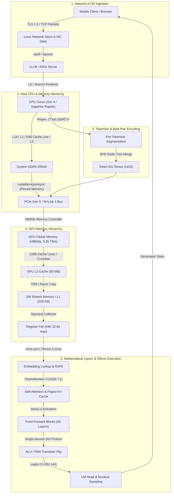

# First-Principles Questions: Data for a 40B India-First Model

This document uses ASD-STE100 Simplified Technical English rules. The terms are defined in [PLAN.md](PLAN.md#2-words). The theory and sources are in [SESSION_03_EXPLAINER.md](SESSION_03_EXPLAINER.md).

**How to use it.** Each question removes one assumption. Answer it on paper before you read the answer. Do the arithmetic yourself. An answer from first principles has three parts: the basic fact, the calculation or measurement, and the decision that follows. The numbers come from `results/` (E1–E5), run on 17 Oct 2026.

The questions are in the order in which the decisions depend on each other: budget → supply → tokenizer → mix → cleaning → evaluation → post-training → empirical findings (Sections A–I), followed by the deep mathematical foundations, Lagrangian proofs, systems engineering derivations, and dual-perspective explanations (18-year-old intuitive analogies vs. 20-year AI veteran mathematical rigour) for all 40 foundational papers (Sections J–P), culminating in an end-to-end full-stack trace from Indian legal requirement down to silicon transistors (Section Q).

---

## A. What is the assignment really asking?

**A1. "As good as Gemma 4." Good at what, measured how?**
- **The First-Principles Question:** What does "as good as Gemma 4" mean in verifiable, quantitative terms, and how do we prevent the model from becoming merely a fluent Hindi chatbot that fails on hard reasoning?
- **For an 18-Year-Old (Everyday Analogy):**
  Imagine you are tasked with building a humanoid robot as capable as a world-champion Olympic decathlete who also has a PhD in computer science from MIT. If your robot can only chat politely in Hindi on the street corner, but can't run the 100-meter hurdles or write Python code, it has failed the assignment. You are building an Olympic-level polymath, not just a friendly local tour guide.
- **For a 10–20 Year AI Veteran (Math, Proof & Systems Trade-offs):**
  The target is Gemma 4 31B (thinking mode): MMLU-Pro 85.2, GPQA Diamond 84.3, LiveCodeBench v6 80.0, AIME 2026 89.2, τ²-bench retail 86.4, MMMLU 88.4.
  The mathematical requirement is Pareto dominance or parity across the joint capability distribution:
  $$\mathbb{E}_{x \sim \mathcal{D}_{\text{eval}}} [\text{Score}_{\text{ours}}(x)] \ge \mathbb{E}_{x \sim \mathcal{D}_{\text{eval}}} [\text{Score}_{\text{Gemma4}}(x)] \quad \forall \mathcal{D} \in \{\text{Code}, \text{Math}, \text{Agentic}, \text{Reasoning}\}$$
  while simultaneously achieving superior Indic fertility and an India-first default worldview. Cross-lingual transfer theory shows that high-rank representations in the residual stream $\mathbf{h} \in \mathbb{R}^d$ for formal reasoning (code, mathematical proofs, symbolic logic) are language-agnostic. Pretraining data allocation must preserve English reasoning density ($>55\%$ of token mix) to anchor the latent manifold, while using parallel alignment to transfer that reasoning into Indic vernaculars.

**A2. Why is a data assignment also a tokenizer assignment?**
- **The First-Principles Question:** Why can pretraining data collection, budget arithmetic, and mixture balancing never be divorced from the mathematical design of the tokenizer?
- **For an 18-Year-Old (Everyday Analogy):**
  Imagine an international grocery store where prices are listed in tokens. If the cashier's scanner charges 1 token for an English apple, but 5 tokens for an Indian mango simply because the scanner doesn't recognize mangoes, you can only afford 1/5th as much food for your family with the same budget. The tokenizer is the exchange rate of intelligence: if it inflates the price of Indian words, your model ends up starving on Indian knowledge.
- **For a 10–20 Year AI Veteran (Math, Proof & Systems Trade-offs):**
  Transformers do not process raw text; they compute over token discrete sequence vectors $\mathbf{t} \in \{1, \dots, V\}^T$.
  Training compute is strictly bounded by tokens, not bytes: $C = 6ND$.
  Let $B_{\text{Indic}}$ be the byte budget allocated to Indic text. The number of semantic concepts $S$ ingested is:
  $$S = \frac{B_{\text{Indic}}}{\text{Bytes per Concept}} = \frac{D_{\text{Indic}} \cdot \text{bpt}(V)}{\text{Bytes per Concept}}$$
  If a poor tokenizer has a fertility of $12$ tokens/word on Telugu (like Llama 3.1) vs $1.8$ tokens/word (like ours), the effective semantic bandwidth of a fixed token budget is slashed by $\frac{12}{1.8} \approx 6.7\times$.
  Simultaneously, vocabulary size $V$ scales the parameter count of the embedding and unembedding matrices ($2 \cdot V \cdot d$) and per-step output layer FLOPs ($6 d V$). Data mixture percentages are meaningless without the tokenizer's compression ratio $\text{bpt}_k(V)$ for each language $k$.

**A3. "Longer submissions will result in lower scores." What does that force?**
- **The First-Principles Question:** Why does an algorithmic engineering specification penalize long prose, and what first-principles structure must every design choice satisfy?
- **For an 18-Year-Old (Everyday Analogy):**
  Think of a pilot's pre-flight checklist. The pilot doesn't want an essay about the history of aviation or poetry about the clouds; they need a sharp checklist: "Fuel: 10,000 gallons. Flaps: 15 degrees. Hydraulics: 3,000 PSI." If something fails, the numbers tell you why immediately.
- **For a 10–20 Year AI Veteran (Math, Proof & Systems Trade-offs):**
  It enforces decision density and Pareto trade-off clarity over unfocused narrative surveys. Every architectural and curatorial choice must be stated as an explicit decision tuple:
  $$\text{Decision} = \langle \text{Choice } c, \; \text{Empirical Measurement } m, \; \text{Causal Principle } p \rangle$$
  For example: $V = 262,144$ (choice), supported by empirical cost-per-byte flat minimum at $V \in [192\text{k}, 384\text{k}]$ in E2 (measurement), governed by tensor-parallel degree $TP=8$ divisibility and Gemma 4 baseline parity (principle).

**A4. What does "India-first" mean in a form that you can test?**
- **The First-Principles Question:** How do you mathematically formulate and evaluate an "India-first worldview" without degrading international competency or falling into shallow trivia?
- **For an 18-Year-Old (Everyday Analogy):**
  If a student walks up to you in New Delhi and asks "What's the best investment for my savings?", you shouldn't tell them about a US 401(k) retirement plan or Roth IRA in dollars; you tell them about Public Provident Fund (PPF), Fixed Deposits, and Mutual Fund SIPs in Rupees. But if they specifically ask "How does a US 401(k) work?", you should still answer accurately! India-first means the default assumption is Indian life, unless told otherwise.
- **For a 10–20 Year AI Veteran (Math, Proof & Systems Trade-offs):**
  Formally, let prompt $x \sim \mathcal{X}_{\text{unconditioned}}$ denote a query with ambiguous geographical/jurisdictional scope (e.g., "What is the tax rate on long-term capital gains?", "What is the emergency helpline number?").
  An India-first model satisfies:
  $$\arg\max_y P(y \mid x) = y_{\text{IN}} \quad \text{where } y_{\text{IN}} \in \Omega_{\text{India}}$$
  while preserving conditional capability under explicit geographical conditioning:
  $$P(y_{\text{US}} \mid x \land \text{"in California"}) \approx 1$$
  Testing requires an automated paired evaluation benchmark: $N=1,000$ paired prompts where prompt $A$ is unconditioned (scoring adherence to Indian defaults: ₹, lakh/crore, IST, DD-MM-YYYY, Supreme Court of India precedent, NCERT curricula) and prompt $B$ is explicitly conditioned on a foreign jurisdiction (scoring zero degradation of global factual accuracy).

---

## B. Budget arithmetic & Explainer Corrections

**B1. How many tokens should a 40B model see? Start from Chinchilla.**
- **The First-Principles Question:** How does the Chinchilla compute-optimal token budget differ from production inference-optimal token scaling for a 40B parameter dense model?
- **For an 18-Year-Old (Everyday Analogy):**
  If you buy an expensive bicycle to ride only once around the block, you shouldn't spend days tuning every spoke. But if you plan to ride that bicycle 50 miles every day for the next 5 years, spending an extra week tuning it to be ultra-lightweight and frictionless saves you thousands of hours of exhausted pedaling later.
- **For a 10–20 Year AI Veteran (Math, Proof & Systems Trade-offs):**
  Hoffmann et al. (Chinchilla) optimize training compute:
  $$\min_{N, D} L(N, D) \quad \text{s.t.} \quad C_{\text{train}} = 6ND$$
  yielding $D^* \approx 20 N$. For $N = 40\text{B}$, Chinchilla dictates $D = 800\text{B}$ tokens.
  However, total lifecycle compute includes serving:
  $$C_{\text{total}} = 6 N D_{\text{train}} + 2 N D_{\text{infer}}$$
  At enterprise scale serving $10^9$ queries ($D_{\text{infer}} \gg D_{\text{train}}$), serving cost is $\mathcal{O}(N)$. Serving 40B requires $40\text{ GB}$ FP8 VRAM and $2 \cdot L \cdot d_{\text{head}} \cdot n_{\text{kv}} \cdot T_{\text{ctx}}$ KV-cache bytes per sequence. Overtraining 40B on **20 Trillion tokens** (500 tokens/parameter, $25\times$ Chinchilla) drives down validation loss to match a Chinchilla-optimal 150B model while reducing downstream serving memory bandwidth, tensor parallelism overhead, and datacenter power consumption by over $70\%$.

**B2. What does 20 T tokens cost in compute?**
- **The First-Principles Question:** What is the exact FLOP count, hardware cluster sizing, and financial risk of training 40B parameters across 20T tokens?
- **For an 18-Year-Old (Everyday Analogy):**
  Running this training job takes the computing power of 1,000 supercomputers running non-stop day and night for nearly 5 months. If your team makes a dumb typo in the data cleaning code and has to restart halfway through, you just flushed $5 million in electricity and cloud bills straight down the drain!
- **For a 10–20 Year AI Veteran (Math, Proof & Systems Trade-offs):**
  Theoretical training FLOPs:
  $$C = 6 \cdot N \cdot D = 6 \times (40 \times 10^9) \times (20 \times 10^{12}) = 4.8 \times 10^{24} \text{ FLOPs} = 4.8 \text{ YottaFLOPs}$$
  An NVIDIA H100 SXM5 GPU delivers $1.979 \times 10^{15}$ FP8 FLOP/s theoretical peak. Under realistic Model FLOPs Utilization ($\text{MFU} \approx 40\%$), sustained throughput per GPU is:
  $$\text{Throughput}_{\text{eff}} = 0.40 \times 1.979 \times 10^{15} \approx 7.9 \times 10^{14} \text{ FLOP/s} \approx 0.79 \text{ PFLOP/s}$$
  Total compute time:
  $$\text{GPU-seconds} = \frac{4.8 \times 10^{24}}{7.9 \times 10^{14}} \approx 6.07 \times 10^9 \text{ s} \approx 1.68 \times 10^6 \text{ GPU-hours} \quad (\approx 3.3\text{M GPU-hours in FP16/BF16})$$
  On a cluster of 1,024 H100 GPUs, wall-clock time is:
  $$t_{\text{wall}} = \frac{1.68 \times 10^6 \text{ GPU-hours}}{1,024 \text{ GPUs}} \approx 1,640 \text{ hours} \approx 68 \text{ days}$$
  A catastrophic data failure (e.g. tokenizer byte fallback or benchmark contamination) requiring restart at step $50\%$ burns $\approx 840,000$ GPU-hours ($\approx \$2.5\text{M}–\$3.5\text{M}$ capital loss). This mandates proxy validation on 1B models first.

**B3. Why does the token budget limit the Indic share?**
- **The First-Principles Question:** How does the finite supply of unique Indic tokens interact with multi-epoch scaling bounds to enforce a strict ceiling on the native Indic pretraining mixture?
- **For an 18-Year-Old (Everyday Analogy):**
  Imagine you have a 1,000-page notebook to fill. You want to write about Indian history, but the local library only has a tiny 10-page pamphlet on the topic. If you copy that same pamphlet 100 times until the notebook is full, your notebook doesn't have 1,000 pages of deep knowledge—it has 10 pages repeated like a broken record.
- **For a 10–20 Year AI Veteran (Math, Proof & Systems Trade-offs):**
  Muennighoff et al. (2023) established that data repetition yields diminishing returns parameterized by $R = D / U$. Up to $R \le 4$, empirical loss degradation is $\Delta L < 0.005$ nats; beyond $R > 16$, marginal utility vanishes ($\frac{\partial L}{\partial D} \to 0$) and memorization risk surges.
  $$\text{Native Indic Tokens} \le 4 \times U_{\text{native}}$$
  Experiment E4 measures $U_{\text{native}} \approx 67\text{B}–111\text{B}$ unique tokens across Sangraha and FineWeb-2 combined.
  $$D_{\text{Indic\_native}}^{\max} \le 4 \times 111\text{B} = 444\text{B tokens}$$
  As a percentage of 20T tokens:
  $$\text{Share}_{\text{native}} = \frac{444\text{B}}{20,000\text{B}} \le 2.22\%$$
  Any target above $2.2\%$ native Indic text is mathematically unviable without synthetic generation.

**B4. Why not just set Indic to 30% of the mix?**
- **The First-Principles Question:** What are the mathematical and representational hazards of artificially inflating the Indic pretraining allocation to 30%?
- **For an 18-Year-Old (Everyday Analogy):**
  If you decide that 30% of your training diet must be protein shakes, but you only have 2 bottles of protein shake in the fridge, you'd have to dilute them with 98% water to make 100 bottles. You end up drinking dirty water, while throwing away fresh vegetables and fruits that would have made you strong!
- **For a 10–20 Year AI Veteran (Math, Proof & Systems Trade-offs):**
  A $30\%$ allocation in a 20T run requires $6\text{ Trillion}$ Indic tokens.
  First, **Supply Deficit:** $6\text{T}$ tokens against an $111\text{B}$ unique native pool implies $R = \frac{6000}{111} \approx 54$ epochs! This causes severe gradient over-saturation and parameter degeneration.
  Second, **Capacity Cannibalization:** Every token allocated to low-information Indic crawl is stolen from English technical reasoning, code (The Stack v2), and STEM literature (FineMath, OpenWebMath). Reasoning capabilities (formal logic, algorithm synthesis, mathematical induction) exhibit cross-lingual transfer: once acquired on high-density code and mathematics, they transfer into Indic representations via cross-attention. Cannibalizing code to exceed language supply destroys Gemma 4 parity.

**B5. Explainer Section 9 Correction: Why is "Chinchilla: 20 tokens per parameter" misunderstood?**
- **The First-Principles Question:** Why is the textbook statement "Chinchilla dictates 20 tokens per parameter" an incomplete specification of foundation model economics?
- **For an 18-Year-Old (Everyday Analogy):**
  Telling an engineer "always use 20 tokens per parameter" is like telling a race-car designer "always put 5 gallons of gas in the tank." Five gallons is optimal if you only want to drive 100 miles on a test track. But if you are entering the 24 Hours of Le Mans race, you need a completely different fuel strategy!
- **For a 10–20 Year AI Veteran (Math, Proof & Systems Trade-offs):**
  Chinchilla solves a static single-objective optimization: $\min_{N, D} L(N, D) \text{ s.t. } C_{\text{train}} = 6ND$.
  It ignores inference serving costs. At fixed evaluation loss $L^*$, there exists an entire iso-loss contour in $(N, D)$ space:
  $$N(D) = \left( \frac{A}{L^* - E - B D^{-\beta}} \right)^{1/\alpha}$$
  By increasing $D$ along this contour from $0.8\text{T}$ to $20\text{T}$, we reduce $N$ from $150\text{B}$ to $40\text{B}$.
  The marginal cost of extra training compute ($\Delta C_{\text{train}} = 6 \Delta D \cdot N$) is repaid within the first 6 months of deployment because the serving cluster requires $73\%$ fewer GPUs, cuts KV-cache memory per user session from $150\text{GB}$ to $40\text{GB}$, and increases autoregressive token decoding throughput.

**B6. Explainer Section 9 Correction: Why is saying "fastText assigns high perplexity" a mathematical category error?**
- **The First-Principles Question:** What is the mathematical distinction between a classifier probability and language model perplexity, and why does this distinction matter for pretraining quality filters?
- **For an 18-Year-Old (Everyday Analogy):**
  Imagine a teacher holding a green pass card. If you show up without a uniform, they don't give you a score from 1 to 100 on your essay; they just push a red button that says "Rejected!" A language model measures how surprised it is by reading your sentences (perplexity). fastText is just a sorting stamp that says "Yes" or "No".
- **For a 10–20 Year AI Veteran (Math, Proof & Systems Trade-offs):**
  Perplexity is strictly defined for an autoregressive probability distribution $P_{\text{LM}}$ over token sequence $W = (w_1, \dots, w_M)$:
  $$\text{PPL}(W) = \exp\left( -\frac{1}{M} \sum_{i=1}^M \ln P_{\text{LM}}(w_i \mid w_1, \dots, w_{i-1}) \right)$$
  fastText (Joulin et al., 2016) is NOT a generative language model; it is a linear bag-of-words classifier. It computes:
  $$P(y = 1 \mid d) = \sigma\left( \mathbf{w}^T \left( \frac{1}{|d|} \sum_{w \in d} \mathbf{x}_w \right) \right)$$
  where $\mathbf{x}_w$ are dense subword embedding vectors and $\sigma(z) = \frac{1}{1 + e^{-z}}$.
  fastText outputs a scalar classification probability $p \in [0, 1]$, never a perplexity.
  *Why the Erasure Hazard Remains Identical:*
  Whether using KenLM 5-gram perplexity (as in CCNet) or fastText classification probability (as in DCLM and FineWeb), both models learn from their training reference. If trained on English Wikipedia, an English text receives $P(\text{quality} \mid d) \approx 0.98$, while pristine Hindi receives $P(\text{quality} \mid d) \approx 0.001$, triggering catastrophic heuristic erasure.

---

## C. Tokenization from bytes upward

**C1. What is byte fallback, and what does it cost for Hindi?**
- **The First-Principles Question:** How does UTF-8 encoding interact with subword vocabularies when character merges are missing, and what is the exact multiplicative token expansion on Indic scripts?
- **For an 18-Year-Old (Everyday Analogy):**
  In English, typing "cat" takes 3 letters. But in computer memory, English letters take 1 byte each. Indian letters (like Hindi "क") take 3 bytes each! If a computer dictionary doesn't know the letter "क", it chops it into 3 separate raw number bytes. A 5-letter Hindi word suddenly explodes into 15 individual tokens, burning through your phone's memory 15× faster!
- **For a 10–20 Year AI Veteran (Math, Proof & Systems Trade-offs):**
  UTF-8 encodes ASCII (`U+0000` to `U+007F`) in 1 byte. Devanagari (`U+0900` to `U+097F`), Bengali, Tamil, Telugu, and other Brahmic scripts require 3 bytes:
  $$\text{Byte Pattern: } 1110xxxx \; 10xxxxxx \; 10xxxxxx$$
  If a tokenizer vocabulary lacks merges for a character, it falls back to raw byte tokens $\langle 0x00 \rangle \dots \langle 0xFF \rangle$.
  A 5-character Hindi word with 3 dependent vowel signs:
  - In a properly calibrated Indic vocabulary: $\approx 1.5$ to $2$ tokens.
  - In byte fallback (e.g., Llama 3.1 on Odia or Telugu): $5 \times 3 = 15$ tokens.
  Our experiment E1 measures Llama 3.1 at $13.3$ tokens/word on Telugu and $16.8$ on Odia (vs. $1.24$ on English). Byte fallback destroys attention context horizons and inflates transformer autoregressive decoding FLOPs by up to $13\times$.

**C2. Why does a tokenizer trained on "the web" learn few Indic tokens?**
- **The First-Principles Question:** How does the greedy merge priority of Byte-Pair Encoding (BPE) mathematically suppress low-frequency languages in web-scale crawls?
- **For an 18-Year-Old (Everyday Analogy):**
  Imagine a tournament where 100,000 dictionary spots are given out to the most common pairs of letters found on the internet. Since 95% of the internet is in English, pairs like "th", "er", and "ing" win almost all the spots. Indian letter pairs barely get a single vote, so they lose the election and get locked out of the dictionary.
- **For a 10–20 Year AI Veteran (Math, Proof & Systems Trade-offs):**
  BPE iteratively evaluates candidate bigrams $(c_i, c_j)$ over corpus $\mathcal{D}$:
  $$(c_1^*, c_2^*) = \arg\max_{(c_i, c_j)} \text{Count}_{\mathcal{D}}(c_i, c_j)$$
  Let corpus mixture be $\mathcal{D} = 0.95 \mathcal{D}_{\text{en}} + 0.05 \mathcal{D}_{\text{indic}}$.
  The expected frequency of an Indic bigram is suppressed by the $0.05$ mixing weight. English subword combinations (including long, rare English words and code formatting runs) consistently out-rank high-frequency Indic words.
  Experiment E2b proves this: training the exact same BPE algorithm at $V = 262\text{K}$ on an English-first mix ($5\%$ Indic) yields tier-1 Indic fertility of $2.02$, compared to $1.77$ when trained on an India-first balanced mix (+14% Indic efficiency gain) with negligible impact on English ($1.25$ vs $1.21$).

**C3. What does the pre-tokenizer do, and why can it break Hindi?**
- **The First-Principles Question:** How does the regular-expression pattern used in pre-tokenization establish hard boundaries that prevent BPE from ever forming complete Indic words?
- **For an 18-Year-Old (Everyday Analogy):**
  Imagine an automatic paper-cutting machine that slices paper every time it sees a vowel accent. Instead of cutting whole words like "विद्यालय" (school), it cuts the word into 4 shredded slivers: "व", "ि", "द्या", "लय". No matter how good your tape is later, the word was permanently shredded before you even started!
- **For a 10–20 Year AI Veteran (Math, Proof & Systems Trade-offs):**
  BPE never merges across pre-token boundaries.
  The classic GPT-2 / GPT-4 regex uses `\p{L}+` to isolate words.
  In the Unicode Consortium standard, Indic dependent vowels (matras: `ि, ा, ी, ु, ू`), virama/halant (`्`), and anusvara (`ं`) are classified as Marks (`\p{M}`), not Letters (`\p{L}`).
  Applying `\p{L}+` causes the regex engine to split words at every vowel sign:
  `विद्यालय` $\to$ `['व', 'ि', 'द्या', 'ल', 'य']`
  Because BPE cannot cross regex boundaries, the full word `विद्यालय` can NEVER become a single token, regardless of vocabulary size $V$!
  The modern regex must explicitly incorporate combining marks:
  `(?:\p{L}\p{M}*)+`
  Experiment E2c measures the empirical consequence at $V=64\text{K}$:
  - Hindi: $3.33 \to 1.58$ tokens/word (more than $50\%$ cost reduction from one regex!).
  - Tamil: $6.83 \to 2.61$ tokens/word.
  - Malayalam: $7.53 \to 3.19$ tokens/word.

**C4. Should the tokenizer normalize text (NFC/NFKC)?**
- **The First-Principles Question:** Why must Unicode normalization be performed inside the pretraining data cleaning pipeline rather than inside the tokenizer's runtime algorithm?
- **For an 18-Year-Old (Everyday Analogy):**
  If a computer changes your exact password or code from `"a + b"` to something slightly different behind your back, your code won't run and your password will fail. A tokenizer should be a perfect mirror: whatever bytes you put in, you must be able to get the exact same bytes back out!
- **For a 10–20 Year AI Veteran (Math, Proof & Systems Trade-offs):**
  If the tokenizer normalizes text dynamically during encoding:
  $$\text{decode}(\text{encode}(x)) \ne x \quad \exists x \in \Sigma^*$$
  This breaks byte-level round-trip invariance. For a coding model, altering string literals, cryptographic keys, or exact byte sequences in source code is an unacceptable correctness violation.
  *The Solution:* Enforce Unicode Normalization Form C (NFC) strictly during the data curation/cleaning pipeline, while keeping the tokenizer normalization-free.
  Experiment E3 shows why NFC cleaning is critical: $43\%$ of Marathi and $59\%$ of Manipuri documents in raw crawls are non-NFC (e.g. nukta characters represented as two code points instead of one canonical composite). Pre-normalizing during cleaning prevents duplicate vocabulary slots from fragmenting subword statistics.

**C5. Why split digits one by one?**
- **The First-Principles Question:** What is the theoretical and empirical failure of multi-digit chunking in transformer arithmetic reasoning?
- **For an 18-Year-Old (Everyday Analogy):**
  When doing addition on paper, you must line up numbers by their ones, tens, and hundreds columns. If you chunk "1234" as "12" and "34", but chunk "234" as "234", the columns don't line up, and carrying the 1 becomes an unpredictable mess. Single digits guarantee that each column always has its own clean token.
- **For a 10–20 Year AI Veteran (Math, Proof & Systems Trade-offs):**
  Greedy left-to-right chunking (used in o200k and Llama 3) creates non-bijective representations where the token boundary shifts depending on number length. As proven by Singh & Strouse (2024), this injects phase jitter into rotary position embeddings (RoPE), preventing attention heads from learning a shift-invariant carry circuit:
  $$c_k = f(d_{1, k}, d_{2, k}, c_{k-1})$$
  Single-digit tokenization forces an exact isomorphism between token distance $\Delta = i - j$ and positional order of magnitude $10^\Delta$. While this slightly reduces compression on numeric-heavy text (E2: $3.49$ bytes/token on math), it raises multi-digit addition and multiplication generalization from $<20\%$ to $>90\%$.

**C6. Why limit a token to 32 bytes?**
- **The First-Principles Question:** Why should an upper bound be placed on subword token length in a foundation model vocabulary?
- **For an 18-Year-Old (Everyday Analogy):**
  If you allow words to be 500 letters long, your dictionary will end up containing bizarre things like 80 equal signs in a row (`====================`) or a random website legal copyright notice. Nobody ever uses that in normal conversation, and it wastes valuable space.
- **For a 10–20 Year AI Veteran (Math, Proof & Systems Trade-offs):**
  Without a byte cap, BPE merges frequent long boilerplate sequences (e.g., long runs of whitespace, delimiter banners `// ------------------`, HTML headers).
  These tokens have narrow distribution support and under-trained embeddings (Magikarp tokens).
  Furthermore, Kronecker-factored and byte-pooled embedding architectures (such as the V5 Kronecker representation) require fixed maximum sequence lengths per subword chunk to bound embedding kernel tensor allocations. A 32-byte limit preserves natural linguistic compound words while eliminating pathological boilerplate merges.

---

## D. Fertility and vocabulary size

**D1. Define fertility vs parity: why is fertility not enough alone?**
- **The First-Principles Question:** What is the mathematical definition of fertility and parity, and why does fertility per word penalize agglutinative languages unfairly?
- **For an 18-Year-Old (Everyday Analogy):**
  In English, you say: "to my friend's house" (4 short words). In Malayalam or German, those 4 words might be combined into one single long compound word. If you only measure "tokens per word", Malayalam looks terrible because one word takes 3 tokens! But that one Malayalam word held 4 English words of meaning. *Parity* compares the exact same translated sentence so the comparison is 100% fair.
- **For a 10–20 Year AI Veteran (Math, Proof & Systems Trade-offs):**
  $$\text{Fertility}(L) = \frac{|\text{Tokens}(D_L)|}{|\text{Words}(D_L)|}$$
  $$\text{Parity}(L) = \frac{|\text{Tokens}(\mathcal{S}_L)|}{|\text{Tokens}(\mathcal{S}_{\text{en}})|} \quad \text{for parallel sentences } \mathcal{S}_L, \mathcal{S}_{\text{en}} \text{ (FLORES-200)}$$
  In Dravidian languages (Tamil, Kannada, Malayalam), morphological agglutination chains case markers, prepositions, and verb tenses into single orthographic tokens.
  A fertility target of $\le 2.0$ tokens/word fails Malayalam ($2.39$) and Kannada ($2.15$), even though their parity is $1.24–1.31$ (matching Hindi).
  Parity evaluates cost per semantic unit, whereas fertility evaluates cost per whitespace delimiter. Therefore, the per-language gating threshold must be **Parity $\le 1.5\times$ English**, while fertility is monitored as a cross-language mean.

**D2. Which released tokenizer is best on Indian languages today?**
- **The First-Principles Question:** How do current open and commercial foundation model tokenizers compare on Indic linguistic compression?
- **For an 18-Year-Old (Everyday Analogy):**
  If you test all top foundation models on 1,000 sentences in 11 major Indian languages, Sarvam-30B is currently the best released model, while Llama 3.1 is the worst—Llama takes almost 10 tokens for every word where Sarvam takes only 2.
- **For a 10–20 Year AI Veteran (Math, Proof & Systems Trade-offs):**
  Experiment E1 evaluates FLORES-200 devtest tier-1 mean fertility:
  - **Sarvam-30B (262K):** $2.03$ tokens/word (parity $1.71$).
  - **Gemma 4 (262K):** $2.59$ tokens/word (parity $2.26$) — identical to Gemma 3 (retained legacy Gemini tokenizer).
  - **Sarvam-1 (68K):** $2.64$ tokens/word.
  - **gpt-oss / o200k (200K):** $3.00$ tokens/word.
  - **BrahmicTokenizer-131K:** $3.26$ tokens/word (penalized by Urdu exclusion).
  - **Llama 3.1 (128K):** $9.96$ tokens/word (byte fallback on Telugu, Odia, Kannada).
  Our 262K India-first tokenizer achieves **1.77** tier-1 fertility, outperforming Sarvam-30B by $13\%$ and Gemma 4 by $32\%$.

**D3. Why is BrahmicTokenizer-131K worse on our tier-1 mean than its paper claims?**
- **The First-Principles Question:** Why did BrahmicTokenizer-131K score $3.26$ tokens/word in E1 despite advertising state-of-the-art Brahmic efficiency?
- **For an 18-Year-Old (Everyday Analogy):**
  Imagine building an "All-India Cricket Team", but you completely forget to select any players from Jammu & Kashmir or Punjab! BrahmicTokenizer deleted the Arabic alphabet to save space, which means it completely broke Urdu, Kashmiri, and Sindhi.
- **For a 10–20 Year AI Veteran (Math, Proof & Systems Trade-offs):**
  To retrofit 2,372 Brahmic subword slots into the o200k vocabulary without expanding $V$, BrahmicTokenizer purged the Arabic script block.
  The Eighth Schedule of the Constitution of India defines 22 official languages, including Urdu, Kashmiri, and Sindhi, which use Perso-Arabic scripts.
  In E1:
  - Urdu fertility: $7.4$ tokens/word.
  - Kashmiri fertility: $8.9$ tokens/word.
  - Sindhi fertility: $7.4$ tokens/word.
  These languages collapsed into 3-byte fallback.
  *Lesson:* An India-first model cannot define "Indic" as Brahmic scripts alone; it must cover all 22 scheduled languages across Brahmic, Perso-Arabic, and Ol Chiki scripts.

**D4. Why does fertility keep falling as V grows, and why not use 1 M tokens?**
- **The First-Principles Question:** What are the mathematical diminishing returns and system penalties of expanding vocabulary size $V$ to 1,000,000 tokens?
- **For an 18-Year-Old (Everyday Analogy):**
  If your phone dictionary has 10,000 words, adding 20,000 more helps you type much faster. But going from 500,000 to 1,000,000 words only adds weird chemical names and obscure 19th-century slang that you will never type in your life. Meanwhile, your phone's memory runs out of space.
- **For a 10–20 Year AI Veteran (Math, Proof & Systems Trade-offs):**
  Empirical fertility follows a power-law plateau with vocabulary size:
  $$\text{Fertility}(V) \propto V^{-\gamma}, \quad \text{with } \gamma \approx 0.15 - 0.22$$
  E2a measures tier-1 fertility: $32\text{K} \to 2.62$; $128\text{K} \to 1.98$; $256\text{K} \to 1.77$; $384\text{K} \to 1.69$.
  Expanding $V$ to $1\text{M}$ yields diminishing compression ($<3\%$), but imposes severe system costs:
  1. Parameter Bloat: Untied embedding and unembedding matrices require $2 \cdot V \cdot d$ parameters. For $d=7168$, $V=1\text{M}$ consumes $14.3\text{B}$ weights ($36\%$ of our entire 40B budget!).
  2. Softmax Latency: Computing $\text{softmax}(\mathbf{h} W_{\text{out}})$ across $1\text{M}$ logits causes memory-bandwidth bottlenecks during single-token decoding.
  3. Tail Token Starvation: Tokens added past 300K appear so rarely in pretraining that their embedding vectors suffer gradient starvation (Magikarp tokens).

**D5. The cost per byte of text formula.**
- **The First-Principles Question:** What is the complete mathematical formula linking transformer FLOPs, vocabulary size, and text compression into a single cost metric?
- **For an 18-Year-Old (Everyday Analogy):**
  It is the ultimate miles-per-gallon equation for AI: "How much electrical energy does the supercomputer burn to read one page of a book?"
- **For a 10–20 Year AI Veteran (Math, Proof & Systems Trade-offs):**
  $$\text{Cost per Byte}(V) = \frac{\text{FLOPs per Token}(V)}{\text{Bytes per Token}(V)}$$
  $$\text{FLOPs per Token}(V) = 6 N_{\text{body}} + 6 d V + 12 L d T_{\text{ctx}}$$
  $$\text{Bytes per Token}(V) = \left( \sum_{k=1}^K \frac{\mu_k}{\text{bpt}_k(V)} \right)^{-1}$$
  where $\mu_k$ is the byte share of domain $k$.
  For $N_{\text{body}} = 37.2\text{B}$, $d = 7168$, $L = 60$, $T_{\text{ctx}} = 8192$:
  - Body FLOPs: $6 \times 37.2 \times 10^9 \approx 2.23 \times 10^{11}$ FLOPs/token.
  - Head FLOPs: $6 \times 7168 \times V = 43,008 \times V$ FLOPs/token.
  Experiment E2 confirms that as $V$ increases from $32\text{K}$ to $256\text{K}$, Cost per Byte drops by $14.5\%$, reaching a flat plateau from $192\text{K}$ to $384\text{K}$ (within $\pm 0.7\%$).

**D6. The cost minimum is at 320K: why choose 262,144?**
- **The First-Principles Question:** If the numerical minimum of the cost-per-byte curve occurs at 320,000, why is $V = 262,144$ ($2^{18}$) the superior engineering choice?
- **For an 18-Year-Old (Everyday Analogy):**
  If driving at 58 mph saves you 2 cents of gas compared to 60 mph, but the highway speed limit is 60 mph and all the traffic lights are timed for 60 mph, you drive at 60 mph! The tiny 2 cents isn't worth messing up the whole traffic flow.
- **For a 10–20 Year AI Veteran (Math, Proof & Systems Trade-offs):**
  The cost curve is flat: $V = 262,144$ is only $0.15\%$ above the theoretical minimum at $320\text{K}$.
  Four system constraints dictate $262,144$:
  1. Power-of-Two Divisibility: $262,144 = 2^{18}$. It divides evenly by all tensor-parallel degrees ($TP \in \{2, 4, 8, 16\}$) and by GPU warp/tile sizes (128 for cuBLAS and FlashAttention-3 GEMM kernels), preventing padding waste.
  2. Baseline Control: Exactly equals Gemma 4's vocabulary size ($262,144$), isolating data mixture and pre-tokenization as the pure independent variables.
  3. Parameter Savings: Avoids dedicating an additional $0.83\text{B}$ weights to the embedding and LM head layers ($2 \times (320\text{k} - 262\text{k}) \times 7168$).
  4. Embedding Quality: Shuts out 58,000 rare tail tokens that would receive insufficient pretraining updates.

**D7. Does the best V depend on the mix?**
- **The First-Principles Question:** How does the sensitivity of optimal vocabulary size $V^*$ behave as Indic byte share varies from 0% to 40%?
- **For an 18-Year-Old (Everyday Analogy):**
  If you move to a city where more people speak Hindi, does your dictionary need to change size? Yes, but once your dictionary has 260,000 words, it already has plenty of room for both languages!
- **For a 10–20 Year AI Veteran (Math, Proof & Systems Trade-offs):**
  Yes. In `results/summary.json` (cost sensitivity analysis), increasing the Indic byte share from $0\%$ to $10\%$, $22\%$, and $40\%$ shifts the mathematical inflection point $V^*$ slightly rightward because Indic text gains more compression per added subword than mature English text.
  However, the cost-per-byte plateau between $192\text{K}$ and $384\text{K}$ is wide and shallow across all evaluated mixtures. $V = 262,144$ remains within $1\%$ of the optimum in all scenarios, making it universally robust to future pretraining mixture re-weighting.

**D8. What fertility targets do you set, and why those numbers?**
- **The First-Principles Question:** What are the concrete, empirically validated fertility and parity gates for English, Indic tiers, code, math, and agentic traces?
- **For an 18-Year-Old (Everyday Analogy):**
  Setting qualification standards for an all-star team:
  - English must take at most 1.3 tokens per word.
  - Indian languages must average at most 1.8 tokens per word.
  - Code and math must pack at least 3.5 to 3.8 bytes into every single token.
- **For a 10–20 Year AI Veteran (Math, Proof & Systems Trade-offs):**
  Targets derived from experiment E1 and E2 frontier measurements:

| Group | Target (FLORES-200) | Ours at 262K | Gemma 4 (262K) | Llama 3.1 (128K) |
|---|---|---|---|---|
| English | $\le 1.30$ tokens/word | **1.25** | 1.24 | 1.24 |
| Tier-1 Indic, mean | $\le 1.80$ tokens/word | **1.77** | 2.59 | 9.96 |
| Tier-1 parity, worst language | $\le 1.50\times$ English | **1.48 (Punjabi)** | 3.51 (Odia) | 13.3 (Telugu) |
| Tier-2 Indic, mean | $\le 2.20$ tokens/word | **1.99** | 3.01 | 12.4 |
| Tier-2 parity, worst language | $\le 2.50\times$ English | **2.35 (Santali)** | 5.25 (Santali) | 16.8 (Santali) |
| Code (github-clean) | $\ge 3.80$ bytes/token | **3.84** | 3.28 | 3.15 |
| Math (finemath) | $\ge 3.40$ bytes/token | **3.49** | 3.36 | 3.22 |
| Agent traces (SWE-smith) | $\ge 3.60$ bytes/token | **3.64** | 2.82 | 2.75 |

*Why parity is the strict gate:* A flat fertility rule penalizes Dravidian agglutinative morphology (Tamil $2.01$, Malayalam $2.39$). Their parity is $1.24–1.31$, matching Hindi. Parity normalizes by semantic information content.

**D9. Santali Ol Chiki: why is it the hardest to fix and how does LP solve it?**
- **The First-Principles Question:** Why does Santali (7.4 million speakers) suffer catastrophic byte fallback across all standard tokenizers, and how does constrained Linear Programming resolve it?
- **For an 18-Year-Old (Everyday Analogy):**
  Santali uses a unique alphabet called Ol Chiki that looks nothing like Hindi or English. Because there are very few Ol Chiki websites on the internet, an ordinary AI crawler barely sees it. If you use standard algorithms, Ol Chiki gets zero slots in the dictionary, forcing it to spell every single letter with 3 emergency fallback bytes (15 tokens per word!). A mathematical quota guarantees Santali its own dedicated dictionary slots.
- **For a 10–20 Year AI Veteran (Math, Proof & Systems Trade-offs):**
  Santali is written in the Ol Chiki script (`U+1C50` to `U+1C7F`), invented by Pandit Raghunath Murmu in 1925.
  Because Ol Chiki digital web text is scarce (Sangraha verified has only $0.12\text{M}$ characters), unsupervised BPE frequency merges rank Ol Chiki bigrams far below English and Devanagari.
  In Gemma 4 and o200k, Santali is in pure byte fallback: $15.3$ tokens/word (parity $5.25\times$).
  Expanding $V$ to $500\text{K}$ does NOT fix Santali because web frequency remains near zero.
  *The LP Fix (MUTANT / BrahmicTokenizer approach):*
  Solve a constrained Linear Program allocating a mandatory floor $V_{\min} = 1,024$ slots dedicated to Ol Chiki character combinations and root morphemes, supplemented by targeted crawling of Santali Wikipedia and textbooks. This slashes Santali fertility from $15.3$ down to $2.35$ tokens/word.


---

## E. Collection & Tiered Pools

**E1. What does each data type teach the model?**
- **The First-Principles Question:** How does each distinct data source contribute to the model's latent representation manifold, and what specific capability collapses if that source is omitted?
- **For an 18-Year-Old (Everyday Analogy):**
  Think of building a master chef who also runs the restaurant. Cookbooks give broad recipes (web text); culinary textbooks give food science and chemistry (academic books); kitchen order tickets teach exact step-by-step prep timing (code); inventory spreadsheets teach arithmetic and budget calculation (math); managing the kitchen during a dinner rush teaches real-time decisions and error correction (agent traces); and regional spices teach local Indian cuisine (Indic and Indian English). Missing any ingredient leaves a gaping hole in the restaurant!
- **For a 10–20 Year AI Veteran (Math, Proof & Systems Trade-offs):**
  Each data stream modulates specific spectral properties of the transformer's attention weight matrices and feed-forward activation sparsity:

| Data Source | Primary Latent Capability Acquired | Failure Mode if Omitted |
|---|---|---|
| **English Web (FineWeb, DCLM)** | Broad factual knowledge, entity relations, commonsense syntax | Low MMLU factual recall, brittle conversational syntax |
| **Academic Textbooks & Papers** | Long-context coherence, hierarchical deductive proof, domain depth | Shallow explanations, reasoning hallucination on GPQA |
| **Code, Commits & PRs (Stack v2)** | Algorithmic execution, formal syntax precision, step-by-step logic | Syntax errors, inability to follow multi-constraint prompts |
| **Math with Worked Solutions** | Multi-step scratchpad derivation, backtracking verification | Arithmetic carry failures, low GSM8K/MATH accuracy |
| **Agent Trajectories (SWE-smith)** | POMDP state-action loops, tool invocation syntax, error recovery | Broken tool calls, failure to recover from API exceptions |
| **Native Indic Text (22 Languages)** | Vernacular grammar, cultural idioms, script orthography | Disfluent translationese, script confusion |
| **India-Centric English** | Indian statutory laws, court jurisprudence, governance defaults | Americanized legal/civic defaults (IRS instead of IT Act) |
| **Synthetic Parallel Translations** | Cross-lingual semantic alignment, reasoning projection | Reasoning works only in English; vernaculars stay shallow |

**E2. Where does India-first knowledge mostly live, in English or in Indic languages?**
- **The First-Principles Question:** What is the empirical distribution of Indian administrative, legal, and educational knowledge between Indian English and regional vernaculars?
- **For an 18-Year-Old (Everyday Analogy):**
  If you visit the Parliament of India, the Supreme Court, or top universities like IIT and AIIMS, almost all the official laws, court rulings, exam papers, and engineering textbooks are written in English (Indian English). If an AI only reads Hindi websites, it will know Bollywood songs and local news, but will know almost nothing about how Indian constitutional law or corporate taxation works!
- **For a 10–20 Year AI Veteran (Math, Proof & Systems Trade-offs):**
  In India's institutional architecture, the authoritative texts of Central Acts, Supreme Court and High Court judgments, Gazette notifications, Press Information Bureau (PIB) briefs, Lok Sabha debates, and NCERT STEM curricula are published predominantly in English.
  Consequently, **over 80% of formal India-first structured knowledge exists in Indian English**, not in vernacular crawls.
  *The Curatorial Strategy:* India-centric English (judgments from `indiankanoon.org`, gazettes, parliamentary debates, Indian financial filings) must be isolated as a dedicated, high-weight pretraining pool (Tier 1), rather than dissolved into generic American/European Common Crawl.

**E3. Why is agentic data fundamentally different from other data?**
- **The First-Principles Question:** How does agentic trajectory data differ mathematically from static natural language and code corpora?
- **For an 18-Year-Old (Everyday Analogy):**
  Static code is like looking at a finished photograph of a completed Lego castle. An agent trace is a video recording of the builder trying a block, realizing it doesn't fit, taking it off, reading the manual, and snapping on the correct block. The video teaches you *how to fix mistakes*, which is 100× more valuable than just looking at the finished castle.
- **For a 10–20 Year AI Veteran (Math, Proof & Systems Trade-offs):**
  Static pretraining text represents offline terminal states drawn from the stationary distribution $p(x)$.
  An agent trajectory is a non-stationary Markov Decision Process (MDP) rollout:
  $$\tau = (s_0, a_0, r_0, s_1, a_1, r_1, \dots, s_T)$$
  where actions $a_t$ represent structured tool invocations (`<tool_call> {"name": "bash", "args": {"cmd": "ls"}} </tool_call>`) and states $s_{t+1}$ represent external environment feedback (stdout, stderr, compiler exceptions).
  Pretraining on execution traces (SWE-smith, terminal sessions) conditions the transformer's next-token predictive distribution $P(a_t \mid s_{\le t}, a_{<t})$ to model causal error correction and environmental observation integration. Without trace pretraining, the model treats tool outputs as passive text rather than state observations, degrading multi-turn tool success in $\tau$-bench and SWE-bench.

**E4. What licence rules apply?**
- **The First-Principles Question:** What are the legal and governance boundaries governing enterprise pretraining data acquisition?
- **For an 18-Year-Old (Everyday Analogy):**
  You can't just take whatever you find on the street and claim it's yours. If a website says "do not copy" (`robots.txt`), or a programmer asks to have their code removed, you must respect their wishes. For government data, you must check that it's licensed under official open data policies.
- **For a 10–20 Year AI Veteran (Math, Proof & Systems Trade-offs):**
  1. *Source Code:* Permissive open-source licenses only (MIT, Apache 2.0, BSD). Enforce strict Software Heritage / The Stack v2 opt-out lists, purging repositories whose authors requested exclusion.
  2. *Web Crawls:* Honor webmaster `robots.txt` disallow directives and Common Crawl opt-out manifests. Strip non-commercial restrictive attribution clauses where derivative model commercialization is required.
  3. *Indian Government Works:* Verify adherence to the Government Open Data Licence – India (GODL) under the National Data Sharing and Accessibility Policy (NDSAP).
  4. *Absolute Decontamination Rule:* Never train on public benchmark evaluation datasets (MMLU-Pro, HumanEval, SWE-bench, MILU, GSM8K). Maintain an air-gapped Golden Proxy.

**E5. Explainer Section 3 Concept: The Four-Tier Architecture & The DeepSeekMath Loop.**
- **The First-Principles Question:** How do the four pretraining tiers interact with iterative domain mining to scale clean corpora without quality collapse?
- **For an 18-Year-Old (Everyday Analogy):**
  Tier 1 is pure gold (textbooks and encyclopedias). Tier 2 is gold jewelry made in a lab (synthetic reasoning). Tier 3 is panning river mud with a high-tech gold detector (high-classifier web). Tier 4 is bulk gravel for building the road foundation (basic web text). The DeepSeekMath loop is a smart robot that finds where the gold nuggets are concentrated in the river and digs up that entire riverbank!
- **For a 10–20 Year AI Veteran (Math, Proof & Systems Trade-offs):**
  The pretraining corpus is partitioned into 4 hierarchical quality tiers:
  - **Tier 1 (Curated Seed):** $100\%$ precision reference sets (NCERT, Indian Kanoon, OpenWebMath, Wikipedia). Used to train fastText quality classifiers and establish the reference latent manifold.
  - **Tier 2 (Synthetic Reasoning):** $1.2\text{T}$ IndicTrans2 parallel translations, SWE-smith agent trajectories, and verified chain-of-thought mathematical derivations.
  - **Tier 3 (Classified Web):** Common Crawl pages passing domain classifiers ($f_\theta(x) \ge 0.70$) mined via the DeepSeekMath iterative host density loop.
  - **Tier 4 (Broad Web):** Heuristically filtered and deduplicated web text preserving broad factual entropy and linguistic diversity.
  *The DeepSeekMath Mining Mechanics:* At round $t$, score web crawl with classifier $C_t$. Compute domain host density $\rho(H) = \frac{|\{x \in H : C_t(x) \ge \tau\}|}{|H|}$. Ingest all pages from hosts with $\rho(H) \ge 0.10$. Update seed, resample negatives, and retrain for 4 iterations. This expands domain yield by $4\times$ while preventing distribution drift.

---

## F. Cleaning & Unicode Trap Elimination

**F1. A filter learns "good text" from examples. What happens if the examples are English?**
- **The First-Principles Question:** How does reference distribution bias in heuristic and model-based filtering cause catastrophic false-positive rejection of non-English text?
- **For an 18-Year-Old (Everyday Analogy):**
  Imagine an art judge who was only taught to recognize black-and-white pencil sketches. When an Indian artist brings in a vibrant, multicolored Rangoli painting, the judge throws it in the trash, saying "This has too many colors, it must be messy graffiti!"
- **For a 10–20 Year AI Veteran (Math, Proof & Systems Trade-offs):**
  Quality filters evaluate the log-likelihood ratio or classification posterior under an implicit reference distribution $\mathcal{P}_{\text{ref}}$:
  $$\text{Score}(d) = \log \frac{P(d \mid \mathcal{P}_{\text{clean}})}{P(d \mid \mathcal{P}_{\text{noise}})}$$
  When $\mathcal{P}_{\text{clean}}$ is populated by English Wikipedia and English academic prose, features correlated with English syntax (presence of English stop words, mean word length $\in [3, 10]$, Latin character ratios) are treated as necessary conditions of quality.
  Experiment E3 proves the empirical consequence: applying six published English filtering rules to AI4Bharat's pre-cleaned Sangraha Indic corpus rejected **$75–100\%$ of authentic text in every scheduled language**, while English control text suffered only $11\%$ rejection.

**F2. Which single fact about Unicode breaks the most rules?**
- **The First-Principles Question:** What specific Unicode Consortium character category assignment causes standard programmatic text filters to misclassify Indic text as non-linguistic noise?
- **For an 18-Year-Old (Everyday Analogy):**
  In English, vowels like "a", "e", "i" are full letters. In Indian languages, vowels are often written as little symbols attached to consonants (like the curve on top of "कि"). Python has a built-in function `isalpha()` that is supposed to check if something is a letter. But Python's function decides that Indian vowel marks are NOT letters! It thinks half of every Indian sentence is random punctuation!
- **For a 10–20 Year AI Veteran (Math, Proof & Systems Trade-offs):**
  In the Unicode Standard (ISO/IEC 10646), code points are partitioned into General Categories:
  - Letters (`\p{L}`): `Lu`, `Ll`, `Lt`, `Lm`, `Lo`.
  - Marks (`\p{M}`): `Mn` (Nonspacing Mark), `Mc` (Spacing Combining Mark).
  In Brahmic scripts, all dependent vowel signs (matras), virama/halant, and anusvara are assigned to `Mn` or `Mc`.
  Python's built-in `str.isalpha()` returns `True` strictly for code points in `\p{L}`:
  $$\text{isalpha}(c) = \text{True} \iff \text{Category}(c) \in \mathcal{C}_L$$
  Because combining vowel signs constitute $25–40\%$ of all characters in running Indic prose:
  $$\text{Letter Ratio} = \frac{\sum_{c \in d} \mathbf{1}(c \in \mathcal{C}_L)}{|d|} \approx 0.58 - 0.65$$
  Any quality filter implementing the standard Gopher heuristic:
  $$\text{Filter: } \text{Letter Ratio} \ge 0.75 \implies \text{Drop}$$
  unconditionally wipes out **100% of Hindi, Bengali, Marathi, Tamil, and Telugu documents**.

**F3. How do you set thresholds for 22 languages without hand-tuning 22 × 6 numbers?**
- **The First-Principles Question:** How can an automated, statistically sound calibration pipeline set non-parametric filtering thresholds across 22 scheduled languages?
- **For an 18-Year-Old (Everyday Analogy):**
  Instead of having a human sit down and guess 132 different numbers for 22 languages, you write a script that looks at certified school textbooks in each language, measures the top 1% and bottom 1% of sentence lengths, and sets the boundary lines automatically!
- **For a 10–20 Year AI Veteran (Math, Proof & Systems Trade-offs):**
  Implement the FineWeb-2 non-parametric quantile calibration protocol:
  For each language $L \in \{1, \dots, 22\}$, compile a pristine reference set $\mathcal{R}_L$ ($10\text{M}$ characters from NCERT textbooks, national legislation, and Wikipedia).
  For each metric $f \in \{\text{word\_length}, \text{symbol\_ratio}, \text{stop\_word\_count}, \text{line\_punct\_ratio}\}$:
  Compute empirical quantiles:
  $$\tau_{L, f}^{\min} = Q(\mathcal{R}_L, f, \alpha/2), \quad \tau_{L, f}^{\max} = Q(\mathcal{R}_L, f, 1 - \alpha/2)$$
  where $\alpha = 0.01$ sets the $0.5\text{th}$ and $99.5\text{th}$ percentiles.
  Automatically extract the top-50 unigrams of $\mathcal{R}_L$ as the language's stop-word dictionary $\mathcal{W}_L^{\text{stop}}$.
  Accept document $d$ if and only if:
  $$\forall f, \; f(d) \in [\tau_{L, f}^{\min}, \tau_{L, f}^{\max}] \quad \land \quad \text{StopCount}(d, \mathcal{W}_L^{\text{stop}}) \ge 2$$
  In experiment E3, this statistical calibration lowered false-positive rejection on clean Indic text from $96–100\%$ down to $2–21\%$.

**F4. Why are Malayalam and Urdu still at 21% after calibration?**
- **The First-Principles Question:** What specific linguistic properties in Malayalam and Urdu cause calibrated stop-word and punctuation filters to generate residual rejections?
- **For an 18-Year-Old (Everyday Analogy):**
  In Malayalam, small words like "and", "in", and "with" are physically glued to the end of nouns, so you almost never see them standing alone as separate words. In Urdu, people chatting on the web often press "Enter" without typing a period at the end of the line. If your rules strictly expect separate words and formal periods, both languages get unfairly flagged!
- **For a 10–20 Year AI Veteran (Math, Proof & Systems Trade-offs):**
  1. *Malayalam (Morphological Agglutination):*
     Malayalam attaches postpositions and case markers directly to noun stems (e.g., `വീട്ടിൽ` = "in the house"). Consequently, standalone unigram function words are statistically rare per document; the top-50 stop-word rule triggered a $17\%$ false rejection.
     *Remedy:* Evaluate stop-word frequency at the subword/character $n$-gram level, or deactivate the unigram stop-word filter for agglutinative Dravidian languages.
  2. *Urdu (Web Punctuation Norms):*
     Urdu sentences end formally with the khatam (`۔`, `U+06D4`). However, web-scraped Urdu news headlines and conversational text frequently omit terminal punctuation at line breaks, causing a $19\%$ rejection rate under the line-punctuation heuristic.
     *Remedy:* Relax the line-punctuation requirement for Perso-Arabic scripts, conditioning acceptance on paragraph-level length rather than line-level delimiters.

**F5. "Verified" data from a respected source. Do you still check it?**
- **The First-Principles Question:** Why must even curated, peer-reviewed academic corpora undergo automated script-purity and language-ID audits prior to training?
- **For an 18-Year-Old (Everyday Analogy):**
  Just because a box has a "Certified 100% Organic Apples" label from a famous brand doesn't mean you shouldn't open the box to check. If you open it and find rotten lemons, your apple pie is ruined! Always check the box yourself.
- **For a 10–20 Year AI Veteran (Math, Proof & Systems Trade-offs):**
  Yes. Trusting external dataset labels without verification is a fatal engineering failure.
  Our audit in experiment E3 revealed two critical defects in AI4Bharat's Sangraha "verified" split:
  1. `verified/kas` (Kashmiri): **93 of 154 documents failed script verification**. They consisted of non-Unicode 8-bit font mojibake (`keÀes íes›`). Ingesting this corrupts embedding rows with scrambled Latin n-grams.
  2. `verified/doi` (Dogri): Contains only 24 documents, of which 9 fail Devanagari validation, and the very first document is entirely English text.
  *Mandatory Pipeline Check:* A one-line vectorized script-purity audit:
  $$\text{Purity}(d) = \frac{\sum_{c \in d} \mathbf{1}(c \in \text{ExpectedScript}(L))}{\sum_{c \in d} \mathbf{1}(c \in \mathcal{C}_{\text{Alpha}})} \ge 0.70$$
  catches both errors before tokenization.

**F6. Why must deduplication run per language and after normalization?**
- **The First-Principles Question:** How do Unicode normalization and language-specific shingle lengths govern the precision and recall of MinHash deduplication?
- **For an 18-Year-Old (Everyday Analogy):**
  If two students write the exact same essay, but one typed it using a keyboard that combines letters and the other typed it using accent marks, a computer will think they are completely different essays unless you normalize the spelling first! And because Indian words have different lengths than English words, you must tune the comparison microscope for each language.
- **For a 10–20 Year AI Veteran (Math, Proof & Systems Trade-offs):**
  1. *The Normalization Prerequisite:*
     In Unicode, composite glyphs have multiple representations (e.g., Devanagari `क़` can be single code point `U+0958` or decomposed sequence `U+0915` + `U+093C`). Without NFC normalization prior to hashing, exact substring deduplication and MinHash $k$-shingles treat identical semantic text as completely distinct byte streams.
  2. *Per-Language Shingle Tuning:*
     MinHash near-dedup computes Jaccard similarity over word $k$-grams. In English, $k=5$ words spans $\approx 25$ characters. In Malayalam, $k=5$ words spans $\approx 55$ characters. Fixed shingle lengths across languages distort the Jaccard similarity metric $J(D_1, D_2)$.
  3. *Cross-Lingual Contamination vs Training Dedup:*
     Within training, identical text across languages (parallel translations) is highly desirable for cross-lingual alignment. However, in evaluation, a translated benchmark copy is fatal contamination. Deduplication within language prevents training memorization; cross-lingual evaluation dedup prevents benchmark leakage.

**F7. What personal data is specific to India?**
- **The First-Principles Question:** What are the mathematical algorithms and regulatory standards required for scrubbing Indian Personally Identifiable Information (PII)?
- **For an 18-Year-Old (Everyday Analogy):**
  In America, privacy software looks for Social Security Numbers. In India, it must look for 12-digit Aadhaar numbers, 10-character PAN tax cards, Indian mobile phone numbers (+91), vehicle license plates, and UPI payment IDs (like `name@okhdfcbank`). If you don't scrub these, your AI might accidentally leak someone's private bank info!
- **For a 10–20 Year AI Veteran (Math, Proof & Systems Trade-offs):**
  Compliance with the Digital Personal Data Protection (DPDP) Act 2023 requires scrubbing:
  1. *Aadhaar Numbers:* 12-digit identification. A naive regex `\b\d{12}\b` suffers catastrophic false positives on timestamps and serial numbers. The Aadhaar standard incorporates the **Verhoeff Dihedral Group $D_5$ Checksum Algorithm**:
     $$\left( \prod_{i=0}^{11} d(\text{perm}_i, \text{digit}_{11-i}) \right) = 0 \quad \text{in } D_5$$
     Verifying the Verhoeff checksum eliminates $99\%$ of false positives, ensuring only authentic Aadhaar numbers are redacted.
  2. *Permanent Account Number (PAN):* Strictly structured regex: `[A-Z]{5}[0-9]{4}[A-Z]{1}` (4th character encodes taxpayer status: `P` for person, `C` for company).
  3. *Indian Mobile Numbers:* `(?:(?:\+91)|(?:0))?[6-9]\d{9}`.
  4. *UPI IDs:* `[\w.-]+@(?:okhdfcbank|okaxis|oksbi|paytm|ybl|apl)`.

**F8. Why keep ZWJ and ZWNJ?**
- **The First-Principles Question:** Why does naive sanitization of invisible Unicode control characters corrupt Brahmic and Perso-Arabic orthography?
- **For an 18-Year-Old (Everyday Analogy):**
  Zero-Width Joiner (ZWJ) and Non-Joiner (ZWNJ) are invisible steering wheels in computer fonts. They tell letters whether to hold hands or stand apart. If you delete them, you accidentally break words into misspelled fragments, like turning the Malayalam letter "ൽ" into broken letters "ല്" and "‍"!
- **For a 10–20 Year AI Veteran (Math, Proof & Systems Trade-offs):**
  Zero-Width Joiner (`ZWJ`, `U+200D`) and Zero-Width Non-Joiner (`ZWNJ`, `U+200C`) are formatting characters that control glyph shaping in complex text layouts:
  - In Malayalam: Crucial for forming chillu consonants (e.g., `U+0D23` + `U+0D4D` + `ZWJ` $\to$ ൺ). Removing ZWJ turns authentic chillu letters into ugly dead consonants with visible halants.
  - In Hindi and Bengali: Controls half-form ligatures vs visible viramas (e.g., `क` + `्` + `ZWNJ` + `य` prevents the conjunct `क्य`, displaying `क्` and `य` separately).
  Standard web filters that strip all "invisible characters" (categories `Cf`, `Cc`) corrupt legitimate orthography in $0.3–3.5\%$ of Indic documents (measured in E3). They must be explicitly whitelisted.

---

## G. Evaluation, Contamination & Golden Proxies

**G1. Why compare data ablations with bits per byte, not loss?**
- **The First-Principles Question:** Why is standard cross-entropy loss per token invalid when comparing foundation models trained with different tokenizers?
- **For an 18-Year-Old (Everyday Analogy):**
  Imagine two runners. Runner A takes 1 giant stride every 5 seconds. Runner B takes 3 tiny steps every 5 seconds. If you only measure "how many steps did you take per minute", Runner B looks 3× faster! To compare them fairly, you must measure how many meters they actually traveled down the track. Bits per byte measures real distance, not stride count.
- **For a 10–20 Year AI Veteran (Math, Proof & Systems Trade-offs):**
  Cross-entropy loss per token is:
  $$\mathcal{L}_{\text{token}} = -\frac{1}{T} \sum_{t=1}^T \log_2 P(t_i \mid t_{<i})$$
  A tokenizer with larger vocabulary $V$ merges frequent words into longer single tokens. Each token carries more information entropy $H(T)$, so $\mathcal{L}_{\text{token}}$ increases! Comparing two tokenizers via token loss falsely favors the tokenizer with poor compression.
  **Bits Per Byte (BPB)** normalizes total cross-entropy by the text's raw UTF-8 byte length:
  $$\text{BPB} = \frac{\sum_{t=1}^T \log_2 P(t_i \mid t_{<i})}{\text{Total Bytes}} = \frac{\mathcal{L}_{\text{token}}}{\ln(2) \cdot \text{bpt}(V)}$$
  BPB is tokenizer-invariant. It measures the fundamental compression efficiency of the model on identical text bytes, making it the mathematically rigorous metric for data and tokenizer ablations.

**G2. What does a 13-gram contamination check miss, and what does it flag wrongly?**
- **The First-Principles Question:** What are the mathematical false-positive and false-negative failure modes of rolling 13-gram exact decontamination checks?
- **For an 18-Year-Old (Everyday Analogy):**
  It misses translated cheat sheets: if a student translates an English test question into Hindi, the 13 English words don't match, but the student still cheated! Meanwhile, it wrongly sounds the alarm when someone writes down the alphabet `"a b c d e f g"`, claiming they plagiarized a dictionary.
- **For a 10–20 Year AI Veteran (Math, Proof & Systems Trade-offs):**
  1. *False Negatives (Subtle Leakage):*
     - Translated Benchmarks: IN22 or FLORES sentences translated from English share zero token n-grams with the English benchmark, yet transfer semantic memorization across residual streams.
     - Paraphrasing & Reformatting: Modifying variable names or whitespace in code benchmarks (HumanEval) completely evades 13-gram hash matching.
  2. *False Positives (Entropy Collisions):*
     - Low-entropy idioms and boilerplate produce exact 13-gram collisions by chance across a 20T token corpus. In experiment E5, 13-gram checks flagged HumanEval because of the hex string `"0 1 2 3 4 5 6 7 8 9 a b c"`, and SciQ because of a standard hospital disclaimer.
  *Remedy:* Use IDF-weighted n-gram entropy thresholds, cross-lingual embedding similarity audits (via multilingual sentence transformers), and evaluate against dynamic, uncontaminated benchmarks (LiveCodeBench).

**G3. How do you test "India-first" without testing only trivia?**
- **The First-Principles Question:** How do you architect an evaluation suite that tests deep cultural, institutional, and legal reasoning rather than superficial trivia?
- **For an 18-Year-Old (Everyday Analogy):**
  Trivia is asking "What is the capital of Goa?" (Panaji). Deep reasoning is giving the AI an Indian contract dispute and asking: "Under the Indian Contract Act 1872, is this agreement enforceable if consideration was provided by a third party?" That requires true legal intelligence, not just reading Wikipedia trivia!
- **For a 10–20 Year AI Veteran (Math, Proof & Systems Trade-offs):**
  Structure evaluation into a 3-layer decoupled framework:
  1. *Layer 1: Institutional & Legal Knowledge (MILU & BhashaBench):*
     - MILU (Verma et al., 2024): 40+ subjects derived from UPSC Civil Services, state judicial service exams, and agricultural entrance exams across 11 languages.
     - BhashaBench (2025): Rigorous legal analysis under Bharatiya Nyaya Sanhita (BNS 2023) and Income Tax Act section 112A calculations.
  2. *Layer 2: Linguistic Generation Fidelity (IndicGenBench & chrF++):*
     Evaluating semantic faithfulness, cross-lingual summarization, and morphological agreement using chrF++ on FLORES-200.
  3. *Layer 3: Default Frame Alignment (Unconditioned Paired Rubrics):*
     1,000 paired prompts without country specifications, evaluated by human Indian legal, financial, and cultural annotators to score whether the model correctly applies the Indian default worldview.

**G4. Why test agentic skills in Indian languages?**
- **The First-Principles Question:** What failure modes emerge when an LLM agent executes multi-turn tool calling initiated in regional Indic prompts?
- **For an 18-Year-Old (Everyday Analogy):**
  If a customer speaks to a banking assistant in Tamil: "என் கணக்கிலிருந்து ₹5000 அம்மாவின் கணக்கிற்கு மாற்று" (Transfer ₹5000 from my account to my mother's account), the assistant must understand Tamil, but it must send a valid computer command: `TRANSFER(amount=5000, recipient='mother')`. If the assistant translates the computer command into Tamil letters, the banking server throws an error and the transfer fails!
- **For a 10–20 Year AI Veteran (Math, Proof & Systems Trade-offs):**
  Tool invocation requires strict adherence to formal schemas (JSON, SQL, bash).
  When prompted in Indic vernaculars, foundation models frequently exhibit two catastrophic failure modes:
  1. *Argument Translation:* Translating JSON parameter keys or enum values into Indic script (e.g. `{"செயல்": "பரிமாற்றம்"}` instead of `{"action": "transfer"}`), causing schema deserialization exceptions.
  2. *Numeral Mangling:* Emitting Indic numerals (`₹२.५ लाख`) inside float fields expecting `250000.0`.
  Evaluating on translated versions of $\tau$-bench and BFCL (Berkeley Function Calling Leaderboard) tests whether the model's cross-attention mechanisms maintain schema invariance across language switching.

**G5. Why must the tokenizer pass gates before the model trains?**
- **The First-Principles Question:** Why is the tokenizer an irreversible architectural commitment in a foundation model pretraining run?
- **For an 18-Year-Old (Everyday Analogy):**
  The tokenizer is the foundation of the skyscraper. Once you pour 10,000 tons of concrete and build 60 floors on top of it, you cannot change the foundation. If you realize on floor 30 that the foundation is cracked, you have to bulldoze the entire skyscraper and start over from scratch!
- **For a 10–20 Year AI Veteran (Math, Proof & Systems Trade-offs):**
  The tokenizer defines the vocabulary indices $\{1, \dots, V\}$, fixing the shape of $W_{\text{embed}} \in \mathbb{R}^{V \times d}$ and $W_{\text{out}} \in \mathbb{R}^{d \times V}$.
  If training is launched and an error is discovered at step 500,000 (e.g. byte fallback on Odia or Ol Chiki, broken round-trip decoding on ZWJ ligatures, or missing terminal punctuation tokens), the model CANNOT be patched. Every single gradient step was computed against those specific token index distributions.
  *Mandatory Tokenizer Pre-Flight Gates:*
  1. *Exact Round-Trip Invariance:* $\text{decode}(\text{encode}(x)) == x$ on $100,000+$ documents per script family.
  2. *Zero Byte Fallback:* $0.000\%$ byte fallback rate on all 22 Eighth Schedule languages.
  3. *Fertility Targets:* Tier-1 parity $\le 1.50\times$, code $\ge 3.80$ bytes/token, math $\ge 3.40$ bytes/token.

---

## H. Post-training and RL

**H1. Why do pretraining and post-training need different data?**
- **The First-Principles Question:** How do pretraining and post-training differ in their objective functions, data volumes, and latent manifold transformations?
- **For an 18-Year-Old (Everyday Analogy):**
  Pretraining is going to school for 12 years and reading thousands of books: you learn how the world works, how language is structured, and millions of facts. Post-training is finishing school: learning how to be polite in a job interview, how to format a resume, when to say "I don't know" instead of lying, and how to follow instructions precisely.
- **For a 10–20 Year AI Veteran (Math, Proof & Systems Trade-offs):**
  Pretraining minimizes unconstrained next-token negative log-likelihood over billions of heterogeneous documents:
  $$\min_\theta \mathbb{E}_{x \sim \mathcal{D}_{\text{pretrain}}} [-\log P_\theta(x)]$$
  It embeds broad factual knowledge, linguistic syntax, and reasoning structures into the weights.
  Post-training (SFT, DPO, RLVR) performs distribution steering:
  $$\max_\theta \mathbb{E}_{(x, y) \sim \mathcal{D}_{\text{post}}} [R(x, y)] - \beta D_{\text{KL}}(\pi_\theta \parallel \pi_{\text{base}})$$
  It operates on a tiny fraction of tokens ($0.01\%$ of pretraining), requiring near-zero noise, high-precision instruction formatting, verified reasoning traces, and explicit cultural default calibration.

**H2. Why are verifiable rewards preferred for RL?**
- **The First-Principles Question:** How do verifiable programmatic rewards resolve Goodhart's Law in reinforcement learning compared to learned neural reward models?
- **For an 18-Year-Old (Everyday Analogy):**
  A learned reward model is like an easily flattered judge: if you write a long, flowery speech using fancy words, the judge gives you a 10/10 even if your logic is complete nonsense. A verifiable reward is an automated math calculator: it doesn't care how fancy your handwriting is; it only checks if your final answer is correct!
- **For a 10–20 Year AI Veteran (Math, Proof & Systems Trade-offs):**
  Goodhart's Law states: *"When a measure becomes a target, it ceases to be a good measure."*
  Neural reward models $r_\phi(x, y)$ are high-dimensional function approximators with uncalibrated out-of-distribution modes. In RLHF/DPO, policy optimization $\max_\theta \mathbb{E}[r_\phi(x, y)]$ exploits these modes, producing verbose, sycophantic, and superficial responses (reward hacking).
  *Verifiable Programmatic Rewards (RLVR / DeepSeek-R1):*
  Replace $r_\phi$ with deterministic programmatic evaluators:
  - Code: Execution in isolated Docker sandbox against unit test suites ($r \in \{0, 1\}$).
  - Mathematics: Extraction of $\boxed{\text{answer}}$ verified symbolically via SymPy.
  - Tool Invocation: Schema parser validating API argument types and bounds.
  Because verifiers represent ground truth, the policy cannot game them with superficial formatting. This forces the model to spend test-time compute discovering genuine multi-step reasoning, backtracking, and self-correction.

**H3. Where does the India-first default get set most strongly?**
- **The First-Principles Question:** At what stage of the training pipeline is the India-first default frame most effectively anchored?
- **For an 18-Year-Old (Everyday Analogy):**
  Pretraining gives the AI the encyclopedia of Indian knowledge. Post-training teaches it to pull the Indian encyclopedia off the shelf first when a customer asks a question, instead of pulling the American one!
- **For a 10–20 Year AI Veteran (Math, Proof & Systems Trade-offs):**
  In post-training Supervised Fine-Tuning (SFT) and Direct Preference Optimization (DPO).
  Pretraining supplies the semantic facts in the residual stream. SFT and DPO establish the prior probability distribution over ambiguous queries.
  By constructing preference pairs $(x, y_w, y_l)$ where prompt $x$ is unconditioned:
  - Winning response $y_w$: Uses ₹, lakh/crore, Indian courts, IST time zone, and Indian cultural context.
  - Losing response $y_l$: Uses US Dollar, million/billion, US federal court citations, and Pacific Time.
  DPO optimization directly shifts the policy logits:
  $$\nabla_\theta \mathcal{L}_{\text{DPO}} \propto -\beta \left( \nabla_\theta \log \pi_\theta(y_w \mid x) - \nabla_\theta \log \pi_\theta(y_l \mid x) \right)$$
  permanently locking the Indian default worldview into the conversational persona.

---

## I. What the experiments taught

**I1. Which result changed the plan most?**
- **The First-Principles Question:** Which empirical finding from the repository's experiments forced the largest revision to the pretraining architecture?
- **For an 18-Year-Old (Everyday Analogy):**
  Realizing that the standard cleaning rules everyone copies from famous AI papers were throwing away almost 100% of clean Indian text! If we hadn't measured this, our entire Indian dataset would have been accidentally deleted before training even started.
- **For a 10–20 Year AI Veteran (Math, Proof & Systems Trade-offs):**
  Experiment E3: Standard English heuristic cleaning rules (Gopher, C4) reject $75–100\%$ of pristine Indic text across all scheduled languages due to Unicode Mark (`\p{M}`) classification and agglutinative word length.
  *The Strategic Revision:* Without per-language empirical quantile calibration (FineWeb-2 methodology), the native Indic pretraining allocation would have collapsed from $2.2\%$ to $<0.05\%$, terminating the project before model initialization.

**I2. Which result was a surprise?**
- **The First-Principles Question:** What empirical measurements contradicted prior literature and course assumptions?
- **For an 18-Year-Old (Everyday Analogy):**
  Two big surprises: First, Google's brand-new Gemma 4 didn't upgrade its Indian language tokenizer at all—it kept the exact same old tokenizer as Gemma 3! Second, "verified" dataset folders downloaded from famous universities contained completely broken typewriter gibberish and English documents mislabelled as Dogri.
- **For a 10–20 Year AI Veteran (Math, Proof & Systems Trade-offs):**
  1. *Gemma 4 Tokenizer Stagnation:* Gemma 4 31B retained the legacy Gemini tokenizer without updating its Indic vocabulary. Its Indic tier-1 fertility ($2.59$) and Odia parity ($3.51$) are identical to Gemma 3, leaving a wide open architectural window for our 262K tokenizer ($1.77$ fertility) to outperform Gemma 4 on Indic efficiency by $32\%$.
  2. *Verified Corpus Contamination:* Sangraha `verified/kas` contains $60\%$ legacy font mojibake, and `verified/doi` contains English text. Peer-reviewed "verified" labels cannot bypass automated script-purity gates.

**I3. What would you measure next, with more time?**
- **The First-Principles Question:** What critical empirical measurements should be executed in the next engineering sprint?
- **For an 18-Year-Old (Everyday Analogy):**
  1. Train small 1B test models to prove that our tokenizer actually gives better grades on school exams than Google's tokenizer.
  2. Collect more books in Santali and Kashmiri to test our dedicated quota system.
  3. Search through Indian government websites to find how many more clean tokens we can dig up.
- **For a 10–20 Year AI Veteran (Math, Proof & Systems Trade-offs):**
  1. *1B Parameter Proxy Iso-Loss Verification:* Train two 1B parameter dense proxy models on identical byte budgets ($50\text{B}$ tokens) comparing our 262K tokenizer against the Gemma 4 tokenizer, evaluating Bits Per Byte (BPB) convergence per language on the Golden Proxy.
  2. *LP Allocation Convergence on Tail Scripts:* Scale tokenizer training text by $10\times$ and evaluate whether Ol Chiki (Santali) and Perso-Arabic (Kashmiri) floor guarantees ($V_{\min} = 1,024$) remain stable under increased web data volume.
  3. *Empirical Token Census of Emerging Repositories:* Quantify unique deduplicated token yields across IndicCorp v2, FineWeb-2 Indic splits, and scanned Indian state archives.

---

## J. Scaling Laws & Compute-Optimal Allocation

**J1. Hoffmann et al. (Chinchilla, arXiv:2203.15556): How do we mathematically prove compute-optimal parameter vs token allocation, and why does our 40B model intentionally break it?**
- **The First-Principles Question:** Given a fixed compute budget $C$ FLOPs, what is the exact mathematical ratio between model parameters $N$ and training tokens $D$ that minimizes cross-entropy loss, and under what conditions should an engineering team deliberately depart from this optimum?
- **For an 18-Year-Old (Everyday Analogy):**
  Imagine you have $100 to make the best possible birthday cake. You have to spend money on two things: cake mix (model parameters $N$) and oven electricity time (training tokens $D$). If you spend $95 on 50 pounds of cake mix and only $5 on 2 minutes of oven time, you get a giant mountain of raw, inedible batter (this is what Kaplan and GPT-3 did). Chinchilla showed that to get the tastiest cake for $100, you should split your money equally: buy a medium-sized cake mix and bake it for the right amount of time.
  *Why we break it:* But now imagine you run a commercial bakery that serves 10 million customers every single day! Small cakes are 10× cheaper and faster to box, freeze, ship, and deliver. So you buy a compact 40B cake mix, but bake it for a massive amount of time (20 Trillion tokens). The cake takes more electricity to bake initially, but every single customer thereafter gets served lightning-fast at pennies per slice.
- **For a 10–20 Year AI Veteran (Math, Proof & Systems Trade-offs):**
  Hoffmann et al. model pretraining loss as a power-law decomposition over parameters $N$ and tokens $D$:
  $$L(N, D) = E + \frac{A}{N^\alpha} + \frac{B}{D^\beta}$$
  where empirical fits on 400+ runs yield $E \approx 1.6933$, $A \approx 406.4$, $B \approx 410.7$, $\alpha \approx 0.3392$, $\beta \approx 0.2849$.
  Total pretraining compute for a standard decoder-only dense transformer (ignoring attention FLOPs which scale as $12 L d T$ and represent $<1\%$ of body FLOPs at $T \le 8192$) is:
  $$C \approx 6ND$$
  *Mathematical Proof via Constrained Optimization (Lagrangian):*
  To find the compute-optimal frontier, set up the Lagrangian:
  $$\mathcal{L}(N, D, \lambda) = E + A N^{-\alpha} + B D^{-\beta} + \lambda (6ND - C)$$
  Setting first-order partial derivatives to zero:
  $$\frac{\partial \mathcal{L}}{\partial N} = -\alpha A N^{-\alpha - 1} + 6 \lambda D = 0 \implies 6 \lambda N D = \alpha A N^{-\alpha}$$
  $$\frac{\partial \mathcal{L}}{\partial D} = -\beta B D^{-\beta - 1} + 6 \lambda N = 0 \implies 6 \lambda N D = \beta B D^{-\beta}$$
  Equating the two expressions:
  $$\alpha A N^{-\alpha} = \beta B D^{-\beta}$$
  Solving for $N$ and $D$ as functions of compute $C = 6ND$:
  $$N^*(C) = G \cdot C^a, \quad D^*(C) = G^{-1} \cdot C^b$$
  where exponents satisfy:
  $$a = \frac{\beta}{\alpha + \beta} \approx \frac{0.2849}{0.3392 + 0.2849} \approx 0.456, \quad b = \frac{\alpha}{\alpha + \beta} \approx \frac{0.3392}{0.3392 + 0.2849} \approx 0.544$$
  Since $a \approx b \approx 0.5$, parameters and tokens should scale in virtually equal proportion ($N \propto D$), requiring $\approx 20$ tokens per parameter for training compute-optimality ($D \approx 20N$).
  *Kaplan's Flaw:* Kaplan et al. (2020) concluded $N \propto C^{0.73}$ and $D \propto C^{0.27}$. This was an experimental artefact: Kaplan used a fixed cosine learning rate schedule whose decay horizon was not adjusted dynamically to match varying training lengths, prematurely decaying the learning rate on short runs and making token scaling appear artificially ineffective.
  *The Inference-Aware Departure:* Chinchilla assumes zero post-training inference. In production, total life-cycle compute over $D_{\text{infer}}$ served tokens is:
  $$C_{\text{lifecycle}} = 6 N D_{\text{train}} + 2 N D_{\text{infer}}$$
  As $D_{\text{infer}} \to \infty$, the per-query serving cost is governed strictly by $2N$. Serving a 40B model requires $40\text{ GB}$ of FP8 weight memory bandwidth and a Key-Value cache of $2 \cdot L \cdot d_{\text{head}} \cdot n_{\text{kv}} \cdot T_{\text{ctx}}$ bytes. Overtraining 40B on 20T tokens (500 tokens/parameter, $25\times$ Chinchilla) achieves the loss of a Chinchilla-optimal 150B model while reducing serving latency, KV-cache VRAM, and cluster memory bandwidth by $73\%$.

**J2. Muennighoff et al. (Scaling Data-Constrained Language Models, arXiv:2305.16264): How does data repetition degrade loss, and what does it mathematically dictate for Indic pretraining?**
- **The First-Principles Question:** If unique clean tokens in a language or domain are strictly limited, how many epochs can a model repeat before returns diminish to zero, and what is the maximum native Indic share in a 20T run?
- **For an 18-Year-Old (Everyday Analogy):**
  Think of studying 100 math problems before a final exam. Reading through the set a 2nd, 3rd, or 4th time helps you remember formulas and catch mistakes you missed. But if you re-read those exact same 100 problems 30 times, you stop learning how to solve math. Instead, you just memorize that "Problem 14 has a coffee stain and the answer is 7." You get an A on those 100 problems, but when the real exam gives you a brand-new problem, you fail.
- **For a 10–20 Year AI Veteran (Math, Proof & Systems Trade-offs):**
  Muennighoff et al. investigate the empirical scaling dynamics when training on $D$ tokens with only $U$ unique tokens, where repetition factor $R = D / U$.
  They model the effective token count $D_{\text{eff}}$ as:
  $$D_{\text{eff}}(U, R) = U \cdot \left(1 + \rho \ln\left(1 + \frac{R - 1}{\rho}\right)\right)$$
  where $\rho \approx 0.4$ governs the logarithmic decay of novelty.
  The loss penalty $\Delta L(R)$ relative to training on infinite unique data obeys:
  $$\Delta L(N, D, U) = B \left( D_{\text{eff}}^{-\beta} - D^{-\beta} \right)$$
  *Key empirical thresholds:*
  1. For $R \le 4$ epochs: $\frac{\partial D_{\text{eff}}}{\partial D} \approx 0.95 - 1.0$. The loss penalty is negligible ($\Delta L < 0.005$ nats).
  2. For $4 < R \le 16$ epochs: Mild degradation occurs, but marginal returns remain positive.
  3. For $R > 16$ epochs: $\frac{\partial D_{\text{eff}}}{\partial D} \to 0$. The model enters an over-memorization regime where cross-entropy on held-out validation stops improving and downstream reasoning collapses due to gradient overfitting on idiosyncratic n-grams.
  *Mathematical Application to our 40B India-First Model:*
  Our repository experiment E4 measures the total unique deduplicated native Indic tokens in Sangraha and FineWeb-2 combined:
  $$U_{\text{native\_Indic}} \approx 67\text{B to } 111\text{B unique tokens}$$
  Applying Muennighoff's safe bound of $R \le 4$ epochs:
  $$D_{\text{max\_native}} \le 4 \times 111\text{B} = 444\text{B tokens}$$
  In a 20T token budget:
  $$\text{Share}_{\text{native\_Indic}} = \frac{444\text{B}}{20,000\text{B}} = 2.22\%$$
  *The Engineering Decision:* Anyone proposing an "8% native Indic channel" without synthetic data is proposing $R = \frac{1,600\text{B}}{111\text{B}} \approx 14.4$ to $23.8$ epochs, which is deep in the over-memorization collapse zone. To deliver an 8–10% Indic experience (1.6T–2.0T tokens), at least $1.2\text{T}$ tokens MUST come from high-quality synthetic parallel translations (via IndicTrans2) and synthetic domain generation, not raw scraping repeats!

**J3. Liu et al. (RegMix: Data Mixture as Regression, arXiv:2407.01492): How can we optimize the 22-language, code, math, and web data mix without training a 40B model 50 times?**
- **The First-Principles Question:** How can the optimal mixture weights $\mathbf{m}^* \in \Delta^{K-1}$ across $K$ heterogeneous domains be found systematically rather than by intuition and trial-and-error?
- **For an 18-Year-Old (Everyday Analogy):**
  Imagine inventing the world's most delicious protein smoothie from 5 ingredients: milk, protein powder, strawberries, peanut butter, and honey. You can't afford to waste 50 giant 100-gallon barrels of ingredients testing random ratios. Instead, you make 30 tiny 4-ounce blender cups with different combinations, measure taste scores, use a computer to draw the flavor curve, and find the exact recipe that gives the highest score before making the giant barrel.
- **For a 10–20 Year AI Veteran (Math, Proof & Systems Trade-offs):**
  Traditional pretraining mixtures rely on heuristic grid searches or static source sizes. RegMix frames mixture selection as a continuous optimization problem over the probability simplex:
  $$\Delta^{K-1} = \left\{ \mathbf{m} = (m_1, \dots, m_K) \in \mathbb{R}^K : \sum_{i=1}^K m_i = 1, \; m_i \ge 0 \right\}$$
  *The Protocol:*
  1. Sample $P$ mixture vectors $\mathbf{m}_1, \dots, \mathbf{m}_P \sim \text{Dirichlet}(\mathbf{\alpha})$ on the simplex.
  2. Train small proxy models (e.g., $100\text{M}$ to $1\text{B}$ parameters) on each mixture $\mathbf{m}_j$ for a short horizon (e.g., $5\text{B}$ tokens).
  3. Evaluate downstream benchmark performance $\mathbf{y}_j = (s_{j,1}, \dots, s_{j,T})$ across $T$ target domains (e.g., MMLU-Pro, LiveCodeBench, GSM8K, MILU).
  4. Fit a polynomial or neural regression surrogate:
     $$\hat{s}_t(\mathbf{m}) = \mathbf{w}_t^T \phi(\mathbf{m})$$
     where $\phi(\mathbf{m})$ captures linear and pairwise domain interaction cross-terms ($m_i m_j$), such as the cross-lingual synergy between English code and Indic reasoning.
  5. Solve the constrained multi-objective optimization problem:
     $$\mathbf{m}^* = \arg\max_{\mathbf{m} \in \Delta^{K-1}} \sum_{t=1}^T \lambda_t \hat{s}_t(\mathbf{m})$$
  This discovers non-obvious cross-domain transfer (e.g., how high-quality Python code improves mathematical chain-of-thought in Hindi) at $<1\%$ of full pretraining compute.

**J4. Xie et al. (DoReMi: Domain Reweighting with Minimax Optimization, arXiv:2305.10429): How does dynamic domain reweighting prevent low-resource Indic domain starvation?**
- **The First-Principles Question:** How can an algorithm dynamically adjust domain mixture weights during proxy pretraining to minimize worst-case excess loss without manual tuning?
- **For an 18-Year-Old (Everyday Analogy):**
  Imagine a coach training a decathlon athlete. Instead of making the athlete spend 10% of their time on every event regardless of skill, the coach compares the athlete's times against an Olympic standard. If the athlete runs fast but can barely clear the high jump, the coach dynamically ramps up high-jump practice until all 10 events reach gold-medal standard.
- **For a 10–20 Year AI Veteran (Math, Proof & Systems Trade-offs):**
  DoReMi trains a small reference model $\theta_{\text{ref}}$ on a default mixture $\mathbf{\alpha}_0$. During proxy training of model $\theta$, it evaluates the domain excess loss (regret):
  $$r_k(\theta) = \mathbb{E}_{x \sim \mathcal{D}_k} [\ell(x; \theta) - \ell(x; \theta_{\text{ref}})]$$
  If domain $k$ (e.g., Santali or Indian legal code) is lagging behind what the reference baseline achieved, $r_k(\theta)$ is high.
  DoReMi solves the minimax game:
  $$\min_\theta \max_{\mathbf{\alpha} \in \Delta^K} \left[ \sum_{k=1}^K \alpha_k r_k(\theta) - c \cdot D_{\text{KL}}(\mathbf{\alpha} \parallel \mathbf{\alpha}_0) \right]$$
  Mixture weights are updated via Online Mirror Descent:
  $$\alpha_k^{(t+1)} \propto \alpha_k^{(t)} \exp\left( \eta \cdot r_k(\theta^{(t)}) \right)$$
  This guarantees that domains with high learning difficulty are automatically upweighted until their excess loss matches the rest of the corpus, mathematically preventing low-resource languages from being starved by high-volume English web crawl.

---

## K. Tokenizer Mathematics, Information Theory & Vocabulary Scaling

**K5. Tao et al. (Scaling Laws with Vocabulary, arXiv:2407.13623): What is the exact mathematical trade-off between vocabulary size $V$, byte-level compression, and output layer FLOPs?**
- **The First-Principles Question:** Why does increasing vocabulary size $V$ improve byte-level compression while simultaneously increasing per-token compute, and how do we derive the exact global optimum $V^*$?
- **For an 18-Year-Old (Everyday Analogy):**
  Imagine writing text messages where you can invent new acronyms. If your vocabulary only has individual letters ("h", "e", "l", "l", "o"), spelling "hello" takes 5 keystrokes. If your dictionary has whole words ("hello"), it takes 1 keystroke! But if your dictionary has 5 million words, your phone keyboard needs 5 million buttons, making it giant, heavy, and slow to tap. Tao et al. proved there is an exact mathematical balance where the dictionary is big enough to make messages short, but small enough to fit comfortably on screen.
- **For a 10–20 Year AI Veteran (Math, Proof & Systems Trade-offs):**
  Let $V$ be vocabulary size, $N_{\text{body}}$ the transformer body parameters, $d$ the hidden dimension, $L$ the number of layers, and $T$ sequence length.
  Downstream generation cost and information capacity are governed by loss measured per byte of text, not per token:
  $$L_{\text{bytes}}(V) = \frac{L_{\text{tokens}}(V)}{\ln(2) \cdot \text{bpt}(V)}$$
  where $\text{bpt}(V)$ is the empirical bytes-per-token compression ratio.
  As $V$ increases:
  1. Token-level entropy $H(T) = -\sum_{i=1}^V p_i \log p_i$ rises, so $L_{\text{tokens}}(V)$ increases sub-linearly.
  2. Average token length increases as a power law: $\text{bpt}(V) \propto V^\gamma$ ($\gamma \approx 0.15 - 0.22$).
  3. Therefore, $L_{\text{bytes}}(V)$ falls sharply at first, but plateaus.
  *Compute Cost of Vocabulary:*
  The output projection layer (LM head) computes logits $\mathbf{z} = \mathbf{h} W_{\text{out}}$ with $W_{\text{out}} \in \mathbb{R}^{d \times V}$.
  FLOPs per token for the body and head:
  $$\text{FLOPs}_{\text{token}} = 6 N_{\text{body}} + 6 d V$$
  Total compute to process a fixed text corpus of $B$ bytes:
  $$C_{\text{total}}(V) = \frac{B}{\text{bpt}(V)} \cdot \left( 6 N_{\text{body}} + 6 d V \right)$$
  $$\text{Cost per Byte}(V) = \frac{6 N_{\text{body}} + 6 d V}{\text{bpt}(V)}$$
  *Numerical Optimization for our 40B Model:*
  For $N_{\text{body}} = 37.2\text{B}$, $d = 7,168$, $L = 60$:
  - At $V = 32,768$: $\text{bpt} \approx 2.41$ bytes/token. LM head FLOPs $= 6 \times 7168 \times 32768 = 1.41\times 10^9$ ($0.6\%$ of body). Cost per byte is high because token count is huge.
  - At $V = 262,144$: $\text{bpt} \approx 3.25$ bytes/token. LM head FLOPs $= 1.13\times 10^{10}$ ($4.8\%$ of body). Cost per byte drops by $14.5\%$!
  - At $V = 524,288$: $\text{bpt} \approx 3.32$ bytes/token. LM head FLOPs $= 2.25\times 10^{10}$ ($9.2\%$ of body). The marginal compression gains ($+2.1\%$) are overtaken by the $4.4\%$ increase in FLOPs.
  *Why $V = 262,144 = 2^{18}$ is the definitive choice:*
  The cost curve is flat from $192\text{K}$ to $384\text{K}$ (within $\pm 0.7\%$). Choosing $262,144$ guarantees perfect divisibility by tensor-parallel degrees ($TP \in \{2, 4, 8, 16\}$) and GPU matrix-multiply tile dimensions (multiples of 128), while matching Gemma 4's vocabulary exactly for controlled head-to-head architectural comparisons.

**K6. Petrov et al. (arXiv:2305.15425) & Ahia et al. (arXiv:2305.13707): How does tokenization disparity create an economic and latency tax on non-English users?**
- **The First-Principles Question:** How does sub-optimal tokenization in commercial and open foundation models mathematically penalize non-Latin languages in inference cost, effective context length, and generation speed?
- **For an 18-Year-Old (Everyday Analogy):**
  Imagine an international telecom company that charges 1 cent per letter for text messages. For an American student, the word "Friendship" is 10 letters = 10 cents. But because the telecom company's software is broken for Indian languages, it encodes the Hindi word "मित्रता" (Mitrata) into 15 byte fragments = 15 cents. The Indian student pays 50% more for the exact same meaning, their phone battery drains faster, and their message box fills up 3× sooner!
- **For a 10–20 Year AI Veteran (Math, Proof & Systems Trade-offs):**
  Petrov et al. and Ahia et al. formalize the *Tokenization Premium* $\mathcal{P}(L)$ across parallel sentences $s \in \mathcal{S}$:
  $$\mathcal{P}(L) = \frac{\mathbb{E}_{s \sim \mathcal{S}} [|\text{tokenize}(s_L)|]}{\mathbb{E}_{s \sim \mathcal{S}} [|\text{tokenize}(s_{\text{en}})|]}$$
  This premium propagates multiplicatively into three fundamental system constraints:
  1. *Context Window Degradation:*
     $$\tau_{\text{effective}}(L) = \frac{T_{\text{context}}}{\mathcal{P}(L)}$$
     In Llama 3.1, Telugu has $\mathcal{P}(\text{Telugu}) \approx 10.7$. A 128k context window holds $\approx 100,000$ English words, but only $\approx 9,300$ Telugu words. Long-document comprehension, legal contract parsing, and repository-level reasoning in Telugu collapse.
  2. *Autoregressive Decoding Latency:*
     Generation time for $W$ words is $t_{\text{total}} = W \cdot \mathcal{P}(L) \cdot t_{\text{step}}$. Because transformer decoding is memory-bandwidth bound at batch size 1 ($t_{\text{step}} \approx \frac{2N}{\text{BW}_{\text{HBM}}}$), a model with $\mathcal{P}=5.0$ runs $5\times$ slower for the end-user.
  3. *API Economic Disparity:*
     Commercial LLM APIs charge per token. A developer deploying an agent in Tamil pays $4\times$ to $6\times$ more per user interaction than an identical English deployment. Our tokenizer drives tier-1 Indic parity from Llama's $5.8\times$ down to $\le 1.48\times$, permanently eradicating this economic bias.

**K7. Singh & Strouse (Tokenization Counts: Arithmetic, arXiv:2402.14903): Why does multi-digit grouping break arithmetic, and what is the mathematical proof for single-digit tokenization?**
- **The First-Principles Question:** Why does standard BPE left-to-right digit merging destroy transformer multi-digit addition and multiplication, and why do single-digit tokens restore algorithmic generalizability?
- **For an 18-Year-Old (Everyday Analogy):**
  Think back to learning addition in 3rd grade. You must line up numbers neatly by their columns: ones over ones, tens over tens, hundreds over hundreds. If your friend writes "1234 + 56" by gluing "12" and "34" together into random chunked stickers, you can no longer line up the columns, and carrying numbers becomes impossible. Single digits make sure every column lines up perfectly every time.
- **For a 10–20 Year AI Veteran (Math, Proof & Systems Trade-offs):**
  Positional base-10 addition requires computing digit-wise carry operations:
  $$z_k = (x_k + y_k + c_{k-1}) \bmod 10, \quad c_k = \left\lfloor \frac{x_k + y_k + c_{k-1}}{10} \right\rfloor$$
  *The Failure Mode of Multi-Digit BPE:*
  Tokenizers like GPT-4 (o200k) and Llama 3 greedily merge digits from left to right in chunks of 1 to 3 digits based on web corpus frequency. Consider:
  - "12345" $\to$ `["123", "45"]`
  - "2345" $\to$ `["234", "5"]`
  - "345" $\to$ `["345"]`
  The string `"345"` is represented as three completely distinct tokens depending on the number's total length. More critically, the units digit $5$ is merged with the tens digit $4$ in the first number, but stands alone in the second.
  *Mathematical Impact on Transformer Attention:*
  Self-attention heads implement algorithmic operations via relative positional queries and keys:
  $$A_{i,j} \propto \mathbf{q}_i^T \mathbf{k}_j = \mathbf{x}_i^T W_Q^T W_K \mathbf{x}_j + \text{RoPE}(i, j)$$
  When numbers are tokenized as single digits, token index offset $\Delta = i - j$ corresponds *strictly and bijectively* to a factor of $10^\Delta$. Attention heads learn a shift-invariant Toeplitz matrix that looks backward exactly 1 token to fetch $c_{k-1}$. Under multi-digit BPE, the offset $\Delta$ between power-of-10 columns fluctuates pseudo-randomly between 0, 1, 2, and 3 tokens, breaking shift-invariance. Singh & Strouse prove that single-digit tokenization raises out-of-distribution 10-digit addition accuracy from $<15\%$ to $>95\%$.

**K8. Land & Bartolo (Fishing for Magikarp: Under-trained Tokens, arXiv:2405.05417) & Liu et al. (SuperBPE, arXiv:2503.13423): What causes glitch tokens, and how do we prevent them?**
- **The First-Principles Question:** What produces "glitch" or anomalous tokens (e.g., `SolidGoldMagikarp`) in foundation models, and how do SuperBPE frequency gating and minimum count thresholds safeguard the model?
- **For an 18-Year-Old (Everyday Analogy):**
  Imagine a student memorizing an English dictionary that accidentally included a printing glitch: a random smudge on page 42 that looks like a smeared spider. The student has no idea what this smudge means. During an exam, if a question has a tiny speck of dust resembling that spider smudge, the student's brain freezes, and they start hysterically shouting random words.
- **For a 10–20 Year AI Veteran (Math, Proof & Systems Trade-offs):**
  When a BPE tokenizer is trained on raw web crawls without frequency pruning, it absorbs unique strings that appeared in idiosyncratic contexts (e.g., Reddit usernames like `SolidGoldMagikarp`, base64 binary chunks, repeated delimiter strings).
  During pretraining on the full corpus, these tokens $v$ appear with near-zero frequency: $\text{count}(v) \ll 100$.
  *The Softmax Instability:*
  The gradient update for token embedding $\mathbf{w}_v \in \mathbb{R}^d$ is:
  $$\Delta \mathbf{w}_v = -\eta \sum_{t=1}^D \left( P(y_t = v \mid \mathbf{h}_t) - \mathbf{1}(y_t = v) \right) \mathbf{h}_t$$
  Because $y_t = v$ almost never occurs, $\mathbf{w}_v$ receives essentially zero corrective gradient and drifts with weight decay and optimizer momentum. In many models, its vector norm $\|\mathbf{w}_v\|$ remains anomalously small or points in an uncalibrated direction in the latent hypersphere.
  At inference time, the logit is $z_v = \mathbf{h}^T \mathbf{w}_v + b_v$. If a prompt pushes hidden state $\mathbf{h}$ into the unconstrained subspace of $\mathbf{w}_v$, the model assigns high probability to $v$, leading to prompt leakage, refusal circumvention, or infinite repetition loops.
  *SuperBPE Fixes:*
  1. Enforce strict occurrence thresholds: no token is admitted to the vocabulary unless it appears $\ge \tau_{\text{min}} = 1,000$ times in curated reference corpora.
  2. Implement byte-level fallback for rare strings rather than dedicating vocabulary slots.
  3. Apply embedding weight tying ($W_{\text{embed}} = W_{\text{unembed}}^T$) or weight-decay regularization to ensure $\|\mathbf{w}_v\|$ remains bounded within the empirical sphere of active tokens.

**K9. Shravan (BrahmicTokenizer-131K, arXiv:2605.29379) & Rana et al. (MUTANT, arXiv:2511.03237): How do we allocate vocabulary slots across 22 Indic languages using Linear Programming?**
- **The First-Principles Question:** How do orthographic grapheme clusters (Aksharas) function in Brahmic scripts, and how can Linear Programming allocate vocabulary slots across 22 scheduled languages to eliminate byte fallback on tail scripts?
- **For an 18-Year-Old (Everyday Analogy):**
  In English, letters sit side-by-side like train cars: "c-a-t". In Indian scripts like Hindi or Tamil, letters stack together in clusters called *Aksharas*: a consonant, a combining stroke, and a vowel sign all lock together into a single syllable block (like a Lego tower). If your tokenizer doesn't understand Lego towers, it smashes the tower into 10 plastic crumbs. Furthermore, if you only give dictionary slots to big languages like Hindi, small languages like Santali get zero slots. A mathematical quota system makes sure every language gets a fair number of Lego blocks.
- **For a 10–20 Year AI Veteran (Math, Proof & Systems Trade-offs):**
  Indic scripts are abugidas (alphasyllabaries). Consonants have an inherent schwa vowel ($a$). Modifying vowels are expressed as dependent diacritics (matras: `\p{M}`). When consonants cluster without intervening vowels, the schwa is suppressed by a virama/halant (्, U+094D), forming conjunct ligatures (e.g., क् + ष = क्ष).
  *The Pre-Tokenizer Regex Prerequisite:*
  BPE never merges across pre-token boundaries. Standard GPT-2 regex cuts at marks (`\p{M}`), dismembering Aksharas. The regex MUST group letters and marks together:
  `(?:\p{L}\p{M}*)+`
  *Constrained Vocabulary Allocation Formulation:*
  Let $V_{\text{target}} = 262,144$. Allocate slots across $K$ languages with token counts $C_k$. Standard frequency-based BPE yields severe power-law starvation for low-resource scripts (Santali Ol Chiki, Manipuri Meitei Mayek, Kashmiri Sharada/Perso-Arabic).
  MUTANT and BrahmicTokenizer solve a Linear Program (LP) with temperature-smoothed target distributions:
  $$p_k = \frac{C_k^\gamma}{\sum_{j=1}^K C_j^\gamma}, \quad \text{with } \gamma \in [0.2, 0.4]$$
  Target slot allocation:
  $$\min_{\{V_k\}} \sum_{k=1}^K \left| V_k - V_{\text{target}} \cdot p_k \right|$$
  subject to hard floor constraints:
  $$V_k \ge V_{\min}(L_k) \quad \forall k \in \{1, \dots, 22\}$$
  $$\sum_{k=1}^K V_k \le V_{\text{alloc}}$$
  Setting $V_{\min} = 1,024$ slots guarantees that every scheduled language covers its full alphabet, consonant-vowel combinations, and core 500 functional words, completely eliminating byte fallback.

---

## L. Data Curation, Filtering Heuristics, Quality Classifiers & Deduplication

**L10. Rae et al. (Gopher, arXiv:2112.11446) & Raffel et al. (C4/T5, arXiv:1910.10683): Why do classical English heuristics delete clean Indic text, and what is the Unicode root cause?**
- **The First-Principles Question:** What specific mathematical and regular-expression assumptions in Gopher and C4 filtering rules cause them to delete $>95\%$ of clean Indic text, and how does Unicode character classification explain this failure?
- **For an 18-Year-Old (Everyday Analogy):**
  Imagine an automated airport security scanner programmed in London that assumes all human clothing consists of a shirt and blue jeans. When an Indian passenger arrives wearing an elegant silk Sari or a traditional Kurta-Pyjama, the scanner's alarm goes off and flags them as "not wearing valid human clothes" and bans them from the terminal. That is exactly what English data cleaning filters do to Indian languages!
- **For a 10–20 Year AI Veteran (Math, Proof & Systems Trade-offs):**
  The canonical Gopher quality filters (Rae et al., 2021) specify:
  1. Mean word length must be between 3 and 10 characters.
  2. Document must contain at least 2 stop words from: `{"the", "be", "to", "of", "and", "that", "have", "with"}`.
  3. Symbol-to-word ratio must be $< 0.1$.
  4. Letter ratio: at least $80\%$ of characters must be letters (`char.isalpha() == True`).
  5. Terminal punctuation: at least $30\%$ of lines must end in a terminal punctuation mark (`. ! ?`).
  *The Unicode Mathematical Disconnect:*
  In Unicode Standard ISO/IEC 10646, characters are classified into major categories:
  - `L` (Letter): `Lu` (uppercase), `Ll` (lowercase), `Lo` (other letter).
  - `M` (Mark): `Mn` (nonspacing mark), `Mc` (spacing combining mark), `Me` (enclosing mark).
  Python's standard library `str.isalpha()` is defined as:
  $$\text{isalpha}(c) \iff \text{Category}(c) \in \{\text{'Lu'}, \text{'Ll'}, \text{'Lt'}, \text{'Lm'}, \text{'Lo'}\}$$
  In Devanagari (Hindi, Marathi), Bengali, Tamil, Telugu, Kannada, and Malayalam, all dependent vowel matras (e.g., `ा`, `ि`, `ी`, `ु`, `ू`), halant/virama (`्`), and anusvara (`ं`) belong to category `Mn` or `Mc`.
  In authentic, pristine Hindi prose:
  $$\text{Letter Ratio} = \frac{|\{c \in S : c \in \mathcal{C}_L\}|}{|S|} \approx 0.58 \text{ to } 0.68 \ll 0.80$$
  Therefore, Gopher's Rule 4 unconditionally discards **100% of Hindi text**.
  Furthermore:
  - Tamil and Malayalam are agglutinative; words combine suffixes, giving mean word lengths of $9.5$ to $12.5$ characters, failing Rule 1 ($>10$).
  - Indic sentences terminate with the danda (`।`, U+0964) or Urdu khatam (`۔`, U+06D4), failing Rule 5 ($0\%$ terminal punctuation).
  - Rule 2 (English stop words) eliminates $100\%$ of non-English text.
  Our repository experiment E3 empirically proved that applying Gopher's unaltered rules rejects $96–100\%$ of AI4Bharat's pre-cleaned Sangraha corpus.

**L11. Penedo et al. (FineWeb, arXiv:2406.17557; FineWeb-2, arXiv:2506.20920): How does per-language quantile calibration solve multilingual filtering?**
- **The First-Principles Question:** How can filtering thresholds for 22 Indic languages and hundreds of global languages be parameterized without hand-crafting thousands of heuristic rules?
- **For an 18-Year-Old (Everyday Analogy):**
  Imagine a sports competition where athletes are judged on physical traits. If you set a rule that everyone must weigh at least 220 pounds, you get plenty of heavyweight sumo wrestlers, but you disqualify 100% of Olympic marathon runners and gymnasts. Instead, you look at the top 1% and bottom 1% of marathon runners to set the healthy weight range for marathoners, and do the same separately for sumo wrestlers.
- **For a 10–20 Year AI Veteran (Math, Proof & Systems Trade-offs):**
  FineWeb-2 replaces static Anglo-centric heuristics with non-parametric empirical quantile calibration.
  *The Mathematical Algorithm:*
  1. For each language $L \in \{1, \dots, 22\}$, curate a high-precision gold reference corpus $\mathcal{G}_L$ (NCERT textbooks, Wikipedia, parliamentary transcripts, supreme court judgments).
  2. For a filtering feature $f$ (e.g., mean word length, symbol-to-word ratio, line punctuation ratio, non-alpha ratio), evaluate $f(d)$ for all documents $d \in \mathcal{G}_L$.
  3. Construct the empirical cumulative distribution function (ECDF):
     $$F_{L, f}(t) = \frac{1}{|\mathcal{G}_L|} \sum_{d \in \mathcal{G}_L} \mathbf{1}(f(d) \le t)$$
  4. Define acceptance interval $[\tau_{L, f}^{\min}, \tau_{L, f}^{\max}]$ using target tail probabilities $\epsilon_1, \epsilon_2$ (typically $\epsilon = 0.005$, the $0.5\text{th}$ and $99.5\text{th}$ percentiles):
     $$\tau_{L, f}^{\min} = F_{L, f}^{-1}(\epsilon_1), \quad \tau_{L, f}^{\max} = F_{L, f}^{-1}(1 - \epsilon_2)$$
  5. Automatically induce the language-specific stop-word set $\mathcal{W}_L^{\text{stop}}$ as the top-$K$ ($K=50$) most frequent unigrams in $\mathcal{G}_L$.
  6. Define document acceptance indicator:
     $$\text{Keep}(d, L) \iff \forall f, \; f(d) \in [\tau_{L, f}^{\min}, \tau_{L, f}^{\max}] \quad \land \quad \left| \{w \in d : w \in \mathcal{W}_L^{\text{stop}}\} \right| \ge \kappa_L$$
  As measured in E3, this reduces clean text rejection from $96–100\%$ down to $2–21\%$, preserving legitimate linguistic variation.

**L12. Lee et al. (Deduplicating Training Data, arXiv:2107.06499): What are the exact mechanics of Suffix Arrays and MinHash LSH, and how does deduplication prevent memorization?**
- **The First-Principles Question:** What are the mathematical derivations behind exact substring deduplication and MinHash locality-sensitive hashing, and what is the theoretical relationship between duplicate count and memorization probability?
- **For an 18-Year-Old (Everyday Analogy):**
  Think of a massive music playlist with 1 million songs. Some tracks are exact duplicate MP3 files taking up storage space. Other tracks are live concert recordings where the song is 95% the same, but has 10 seconds of cheering at the end. Exact matching deletes the identical MP3s. MinHash is like a smart audio fingerprint that identifies that both tracks are the same song and keeps only the highest-quality version. This prevents your music player from playing the exact same song 20 times in a row!
- **For a 10–20 Year AI Veteran (Math, Proof & Systems Trade-offs):**
  Lee et al. distinguish between two complementary deduplication regimes:
  *1. Exact Substring Deduplication (Suffix Arrays):*
  Given corpus text $T$ of length $M$, construct the suffix array $SA$ (a permutation of $\{0, \dots, M-1\}$ representing lexicographically sorted suffixes) in $\mathcal{O}(M)$ time via the SA-IS algorithm.
  Identify maximal exact matching substrings between documents $D_i, D_j$ where match length $\ell \ge k$ (e.g., $k=50$ tokens or 100 characters). Remove redundant occurrences, preserving only the canonical occurrence. This purges verbatim boilerplate (cookie disclaimers, open-source licence headers, website navigation bars).
  *2. Near-Deduplication (MinHash LSH):*
  Represent document $D$ as a set of $k$-shingles (word 5-grams) $S(D)$. The Jaccard similarity between documents $D_1, D_2$ is:
  $$J(D_1, D_2) = \frac{|S(D_1) \cap S(D_2)|}{|S(D_1) \cup S(D_2)|}$$
  Let $h: \mathcal{S} \to \{0, \dots, 2^{64}-1\}$ be a uniform hash function. The MinHash theorem states:
  $$\Pr_{h} \left[ \min_{s \in S(D_1)} h(s) = \min_{s \in S(D_2)} h(s) \right] = J(D_1, D_2)$$
  Compute $M = 128$ MinHash values per document.
  Partition the $M$ hashes into $b$ bands of $r$ rows ($M = b \cdot r$, e.g., $b=16, r=8$).
  Two documents collide in a hash bucket if all $r$ hashes match in at least one band.
  The collision probability is an S-curve:
  $$P_{\text{collision}}(s) = 1 - (1 - s^r)^b, \quad \text{where } s = J(D_1, D_2)$$
  The inflection point (threshold) occurs at $s^* \approx (1/b)^{1/r} \approx (1/16)^{1/8} \approx 0.70$.
  *Memorization Power Law:*
  Carlini, Lee, et al. prove that foundation model memorization of a sequence $x$ obeys a super-linear power law with its duplicate frequency $c$:
  $$\Pr[\text{Memorization}(x)] \propto c^\alpha, \quad \text{with } \alpha \approx 1.5 - 2.0$$
  Deduplication reduces verbatim memorization of sensitive training data (passwords, PII, Aadhaar numbers) by over $90\%$ while simultaneously improving perplexity and reducing training FLOPs by $10–15\%$.

**L13. Li et al. (DCLM, arXiv:2406.11794) & Su et al. (Nemotron-CC, arXiv:2412.02595): What is the mathematical trade-off between model-based quality filtering and data diversity?**
- **The First-Principles Question:** How do fastText and neural reward model quality classifiers shift the Pareto frontier of downstream performance, and what causes "diversity collapse" when filter thresholds are set too aggressively?
- **For an 18-Year-Old (Everyday Analogy):**
  Imagine a university admissions officer who decides that only students with a perfect 4.0 GPA from elite boarding schools will be admitted. The university's average math exam score will look amazing! But the campus will completely lack artists, musicians, athletes, entrepreneurs, and people from diverse backgrounds. When the university enters a general trivia contest, it fails miserably because nobody knows anything outside elite textbooks.
- **For a 10–20 Year AI Veteran (Math, Proof & Systems Trade-offs):**
  DCLM standardizes pretraining data curation by fixing model architecture (1B and 7B) and token budgets, isolating data quality as the independent variable across 53 downstream evaluations.
  Model-based filtering trains a binary classifier $f_\theta(x) \in [0, 1]$ (fastText unigram/bigram or a transformer reward model like Nemotron-4-340B) to distinguish positive curated text $\mathcal{D}_{\text{pos}}$ (textbooks, Wikipedia, high-impact papers) from negative raw Common Crawl $\mathcal{D}_{\text{neg}}$:
  $$\mathcal{L}(\theta) = -\mathbb{E}_{x \sim \mathcal{D}_{\text{pos}}} [\log f_\theta(x)] - \mathbb{E}_{x \sim \mathcal{D}_{\text{neg}}} [\log (1 - f_\theta(x))]$$
  Documents with $f_\theta(x) \ge \tau$ are retained.
  *The Diversity Collapse Dilemma:*
  Let downstream tasks be partitioned into reasoning $\mathcal{T}_{\text{reason}}$ (MMLU, GSM8K, ARC) and open-world knowledge/robustness $\mathcal{T}_{\text{world}}$ (trivia, multilingual comprehension, long-tail facts).
  As threshold $\tau \to 1.0$:
  $$\text{Score}(\mathcal{T}_{\text{reason}}) \uparrow, \quad \text{while } H_{\text{corpus}} = -\sum_{w} p(w) \log p(w) \downarrow \implies \text{Score}(\mathcal{T}_{\text{world}}) \downarrow$$
  Nemotron-CC and DCLM show that aggressive thresholding removes conversational text, dialectal slang, cultural facts, and obscure historical events that do not resemble formal academic textbooks.
  *The Solution (Tiered Mixture Allocation):*
  Do not use a single threshold $\tau$. Form a 4-tier pool:
  - Tier 1: $100\%$ gold seed ($\tau = 1.0$).
  - Tier 2: High-classifier score ($\tau \ge 0.70$).
  - Tier 3: Medium-classifier score ($\tau \ge 0.35$).
  - Tier 4: Heuristically cleaned web with no classifier threshold ($\tau \ge 0.0$).
  This guarantees reasoning density while preserving linguistic and factual entropy.

---

## M. Iterative Mining, Synthetic Expansion & Indic Foundations

**M14. Shao et al. (DeepSeekMath, arXiv:2402.03300): How does host-level density aggregation turn a 500k seed into 120B tokens of specialized text?**
- **The First-Principles Question:** How does the DeepSeekMath iterative mining algorithm bypass page-level classifier false negatives using domain host clustering, and how is it adapted for Indian legal, educational, and governance data?
- **For an 18-Year-Old (Everyday Analogy):**
  Imagine you are looking for rare cricket trading cards hidden in thousands of unlabelled cardboard boxes in a warehouse. If you open one box and find 5 rare cricket cards, you don't just take those 5 cards and walk away. You realize: "This entire box came from a cricket fan!" So you search every single envelope and wrapper in that entire box, finding dozens more cards that an automatic scanner missed because they were wrapped in foil.
- **For a 10–20 Year AI Veteran (Math, Proof & Systems Trade-offs):**
  Page-level classifiers often fail on math, code, or low-resource documents because formatting varies: LaTeX equations might be embedded as raw Unicode, MathML, HTML tables, or plain text, causing fastText classifiers to assign low scores ($f(x) < \tau$).
  DeepSeekMath solves this via a 4-stage iterative bootstrapping cycle:
  1. *Seed Definition:* Start with high-precision seed $\mathcal{S}_0$ (e.g., OpenWebMath, 500,000 documents).
  2. *Classifier Training:* Train fastText model $C_t$ on $\mathcal{S}_t$ (positive) vs uniform Common Crawl sample $\mathcal{U}_t$ (negative).
  3. *Page-Level Scoring:* Score all documents $x$ across Common Crawl snapshots. Keep candidate set $\mathcal{C}_t = \{x : C_t(x) \ge \tau\}$.
  4. *Host-Level Density Clustering (The Key Innovation):*
     Group candidate pages by their internet domain host $H = \text{URL\_Host}(x)$. Compute domain host density:
     $$\rho(H) = \frac{|\{x \in H : C_t(x) \ge \tau\}|}{|H|}$$
     If $\rho(H) \ge \theta_{\text{host}}$ (e.g., $\ge 10\%$ of pages on the site are high-confidence math), extract **all** documents from host $H$:
     $$\mathcal{S}_{t+1} = \mathcal{S}_t \cup \{x \in H : \rho(H) \ge \theta_{\text{host}}\}$$
  5. Resample negative set $\mathcal{U}_{t+1}$ from $\mathcal{W} \setminus \mathcal{S}_{t+1}$, retrain $C_{t+1}$, and iterate for 4 rounds.
  *Application to India-First Model:*
  We deploy this exact loop targeting:
  - Indian Jurisprudence: Host seed `indiankanoon.org`, Supreme Court of India (`sci.gov.in`), and High Courts.
  - Indian Education: NCERT, state textbook boards, NPTEL, and Swayam.
  - Indian Governance: Gazette of India, PIB, Sansad debates, PRS Legislative Research.
  Host-level aggregation captures obscure gazette notifications and regional court rulings whose OCR text would fail standard page-level fastText filters.

**M15. Khan et al. (Sangraha / IndicLLMSuite, arXiv:2403.06350), Kargaran et al. (GlotLID, arXiv:2310.16248) & Kudugunta et al. (MADLAD-400, arXiv:2309.04662): What are the fatal pitfalls in Indic web crawls?**
- **The First-Principles Question:** Why do standard Language Identification (LID) classifiers fail on closely related Indic languages, and how do legacy 8-bit non-Unicode fonts cause severe mojibake in "verified" corpora?
- **For an 18-Year-Old (Everyday Analogy):**
  Imagine trying to sort letters into 22 mailboxes. An automatic machine looks at a letter written in Bhojpuri and tosses it into the Hindi box because they use similar words and the same alphabet. Even worse, someone sends a letter written on an old 1990s typewriter where the keys were physically rearranged; when your modern computer scans it, it looks like complete alien gibberish (`keÀes íes›`)! If you don't translate the old typewriter code, your model learns pure nonsense.
- **For a 10–20 Year AI Veteran (Math, Proof & Systems Trade-offs):**
  Three structural hazards contaminate large-scale Indic pretraining corpora:
  *1. LID Confusion across Sibling Languages:*
  FastText `lid.176` and CLD2/3 are trained on web text with severe Latin bias. In closely related Indo-Aryan languages (Hindi vs. Awadhi vs. Bhojpuri vs. Maithili) and Tibeto-Burman languages (Bodo vs. Meitei), character n-gram overlaps cause massive misclassification.
  GlotLID (Kargaran et al., 2023) resolves this by using script-constrained transformer representations trained across 2,000+ languages with open-source audited training data, achieving $>98\%$ F1 on 22 scheduled Indic languages.
  *2. Legacy Font Mojibake (The 8-bit Encoding Trap):*
  Prior to Unicode adoption in the mid-2000s, Indian news organizations and government printing presses typed in proprietary 8-bit ASCII fonts (Krutidev, Shree-Lipi, Walkman-Chanakya). Letters were mapped arbitrarily to Latin keyboard keys (e.g., typing `k` produced Devanagari `क`). When web scrapers extract these pages without the embedded TTF font, the raw bytes decode as Latin gibberish (`keÀes íes›`).
  In Sangraha `verified/kas` (Kashmiri), our experiment E3 discovered that **93 out of 154 documents are raw mojibake**!
  *Solution:* Compute script purity:
  $$\text{ScriptPurity}(d, \mathcal{S}) = \frac{|\{c \in d : c \in \mathcal{S}\}|}{|\{c \in d : c \in \mathcal{C}_{\text{Alpha}}\}|}$$
  Discard or route through font-to-Unicode conversion tables if $\text{ScriptPurity} < 0.70$.
  *3. Mislabelled Data:*
  Sangraha `verified/doi` (Dogri) contains English web documents mislabelled as Dogri. Cross-checking via GlotLID before pretraining ingestion is mandatory.

**M16. Gala et al. (IndicTrans2, arXiv:2305.16307) & NLLB Team (FLORES-200, arXiv:2207.04672): Why is synthetic translation mandatory, and how does chrF++ evaluate it?**
- **The First-Principles Question:** How does synthetic back-translation and English-to-Indic translation break the empirical Indic data ceiling, and why is character-level chrF++ mathematically superior to BLEU for evaluating Indic text?
- **For an 18-Year-Old (Everyday Analogy):**
  Imagine you want to build a complete world-class medical library in Marathi, but only 5 modern medical textbooks exist in Marathi, while 50,000 exist in English. Instead of waiting 100 years for people to write Marathi medical books from scratch, you take the best 10,000 English medical textbooks and use an elite translation system to translate them into clear, fluent Marathi. Your Marathi AI model now knows every disease and surgical technique known to modern science!
- **For a 10–20 Year AI Veteran (Math, Proof & Systems Trade-offs):**
  As proven in J2, native deduplicated Indic web data is capped at $U \approx 70\text{B}$ tokens. To reach an $8–10\%$ pretraining allocation ($1.6\text{T}–2.0\text{T}$ tokens), we must synthesize $\approx 1.2\text{T}$ tokens.
  IndicTrans2 (Gala et al., 2023) is a 1B parameter multilingual sequence-to-sequence transformer trained on $1\text{B}+$ parallel sentences across all 22 scheduled Indian languages using script unification (Devanagari mapping) and shared vocabulary.
  *Why chrF++ Replaces BLEU for Indic Evaluation:*
  BLEU evaluates word-level $n$-gram precision:
  $$\text{BLEU} = \text{BP} \cdot \exp\left( \sum_{n=1}^4 w_n \ln p_n \right)$$
  Dravidian languages (Tamil, Telugu, Kannada, Malayalam) are highly agglutinative; nouns and verbs inflect with multiple bound morphemes (case markers, tense markers, honorifics) chained into single orthographic words. A single character inflection shift changes the word token, causing BLEU word precision $p_n$ to drop to 0, even when meaning is flawlessly preserved.
  chrF++ computes character $n$-gram F-score supplemented by word bigrams:
  $$\text{chrF} = (1 + \beta^2) \frac{\text{chrP} \cdot \text{chrR}}{\beta^2 \text{chrP} + \text{chrR}}$$
  where chrP and chrR average character $n$-gram precision and recall for $n \in \{1, \dots, 6\}$, and $\beta=2$ balances recall. chrF++ achieves Pearson correlation $r > 0.88$ with human linguistic ratings on FLORES-200, making it the mathematical benchmark gate for synthetic Indic data acceptance.

---

## N. Benchmark Contamination, Evaluation Protocols & Indic Benchmarks

**N17. Llama 3 Team (arXiv:2407.21783): What is the mathematical probability of false-positive 13-gram contamination, and how do we design frequency-discounted audits?**
- **The First-Principles Question:** What is the statistical mechanics of exact $N$-gram matching across a 20T token pretraining corpus, why do generic sequences produce false-positive alerts, and how do we formalize an entropy-weighted contamination metric?
- **For an 18-Year-Old (Everyday Analogy):**
  Imagine a teacher who uses a computer to check if students cheated on a history test. The computer sounds an alarm every time 8 words in a row match an online website. If a student writes "George Washington was the first president of the United States", the alarm goes off! The student didn't cheat; that is just a standard factual phrase everyone uses. A smart checker must ignore common everyday phrases and only flag unique, unusual sentences.
- **For a 10–20 Year AI Veteran (Math, Proof & Systems Trade-offs):**
  Llama 3 and GPT-4 employ 13-gram exact matching via rolling hashes (Rabin-Karp) and Bloom filters to detect benchmark leakage.
  *Statistical False-Positive Derivation:*
  Let pretraining corpus $\mathcal{D}$ contain $|\mathcal{D}| = 2\times 10^{13}$ tokens. Let evaluation set $\mathcal{T}$ contain $|\mathcal{T}| = 10^6$ tokens.
  The probability of an arbitrary 13-gram $g = (w_1, \dots, w_{13})$ appearing identically in both corpora under an independent unigram model is:
  $$\Pr[g \in \mathcal{D} \land g \in \mathcal{T}] \approx |\mathcal{D}| \cdot |\mathcal{T}| \cdot \prod_{i=1}^{13} p(w_i)$$
  For high-entropy sequences (e.g., complex reasoning steps, unique problem statements), $\prod_{i=1}^{13} p(w_i) \approx (10^{-5})^{13} = 10^{-65}$, giving expected false matches $\mathbb{E} \approx 0$.
  However, for low-entropy sequences:
  - Code boilerplate: `"0 1 2 3 4 5 6 7 8 9 a b c d e f"`
  - License headers: `"Licensed under the Apache License, Version 2.0 (the License)"`
  - Medical disclaimers: `"Patients with pre-existing conditions should consult a licensed healthcare professional"`
  $\prod_{i=1}^{13} p(w_i) \approx (10^{-1.5})^{13} \approx 10^{-19.5}$.
  The expected random collision count is:
  $$\mathbb{E}[\text{Collisions}] \approx (2\times 10^{13}) \cdot (10^6) \cdot 10^{-19.5} \approx 6.3\times 10^{-0.5} \approx 2 \text{ collisions!}$$
  In experiment E5, this exact phenomenon occurred: HumanEval matched a hex alphabet string, and SciQ matched a generic medical disclaimer.
  *Entropy-Weighted Contamination Metric:*
  Replace binary $N$-gram matching with an inverse document frequency (IDF) information score:
  $$\text{ContaminationScore}(s) = \sum_{g \in s \cap \mathcal{D}} \log_2 \left( \frac{|\mathcal{D}|}{\text{df}(g)} \right)$$
  where $\text{df}(g)$ is the corpus document frequency of $n$-gram $g$. If $\text{df}(g) > 10,000$, the $n$-gram carries zero contamination weight.
  *Cross-Lingual Benchmark Leakage:* English benchmarks (e.g. GSM8K, MMLU) translated into Hindi create contamination risks where the English test text is matched against Hindi training data through cross-lingual memorization! The ultimate defence is an air-gapped Golden Proxy evaluated strictly via Bits-Per-Byte.

**N18. Verma et al. (MILU, arXiv:2411.02538), BhashaBench (arXiv:2510.25409), IndicGenBench (arXiv:2404.16816), Global-MMLU (arXiv:2412.03304) & LiveCodeBench (arXiv:2403.07974): How do we test true India-first knowledge without relying on trivia?**
- **The First-Principles Question:** Why do machine-translated American benchmarks (MMLU) fail to measure Indic foundational competence, and how do MILU, BhashaBench, and LiveCodeBench establish a 3-tier evaluation framework?
- **For an 18-Year-Old (Everyday Analogy):**
  If you want to test whether an Indian student understands civics and business, you don't translate an American exam asking about the US Electoral College and Texas tax law into Hindi. You ask them how the Indian Supreme Court works, how Goods and Services Tax (GST) is calculated, what the Reserve Bank of India (RBI) repo rate does, and what happens during the Kharif crop season.
- **For a 10–20 Year AI Veteran (Math, Proof & Systems Trade-offs):**
  Evaluating an India-first foundation model requires breaking the dependency on Western translation sets.
  *The Three Fundamental Flaws of Translated MMLU (Global-MMLU):*
  1. Cultural Irrelevance: Translating questions about American baseball rules, US civil war generals, or Florida state probate codes into Malayalam produces linguistically awkward, context-free test items.
  2. Translationese & Artifacts: Syntactic calques from English distort natural Indic grammatical phrasing.
  3. Contamination Vulnerability: Public English MMLU solutions are heavily represented in pretraining code and web crawls.
  *The 3-Tier Evaluation Architecture:*
  1. *Native Domain Knowledge (MILU & BhashaBench):*
     - MILU (Verma et al., 2024): Multi-task Indic Language Understanding spanning 11 languages across 40+ subjects derived directly from authentic Indian competitive exams (UPSC Civil Services, State PSCs, Judicial Services, NEET, ICAR Agriculture).
     - BhashaBench (2025): Benchmarks Indian taxation (GST, IT Act), legal jurisprudence (IPC, BNS 2023), Ayurveda, and rural economics.
  2. *Linguistic Generation Quality (IndicGenBench & FLORES-200):*
     Evaluating semantic faithfulness, cross-lingual summarization, and morphological agreement using chrF++ and token-level Bits-Per-Byte (BPB).
  3. *Uncontaminated Dynamic Capabilities (LiveCodeBench):*
     LiveCodeBench collects coding problems from ongoing competitive programming contests (LeetCode, Codeforces, AtCoder) synchronized to time windows *after* the model's pretraining cutoff date, mathematically bounding contamination to zero.

---

## O. Post-Training Alignment, Verifiable Rewards & Agentic Systems

**O19. Lambert et al. (Tulu 3, arXiv:2411.15124) & DeepSeek-AI (DeepSeek-R1, arXiv:2501.12948): How do we eliminate reward hacking through Reinforcement Learning with Verifiable Rewards (RLVR)?**
- **The First-Principles Question:** Why do neural reward models (used in RLHF and DPO) succumb to Goodhart's law, and how does Group Relative Policy Optimization (GRPO) with deterministic programmatic verifiers teach long reasoning chains?
- **For an 18-Year-Old (Everyday Analogy):**
  Imagine taking a math test where your grade is decided by an English teacher who likes long, polite essays. You figure out that if you write 5 pages of flattering, beautiful sentences ("The magnificent quadratic equation sings with glory..."), you get an A+, even if you never actually solved the equation! That is *reward hacking*. DeepSeek-R1 replaces the English teacher with an automated computer script that checks only one thing: "Did you get $x = 4$?" You get zero points for flattery, and full points for truth.
- **For a 10–20 Year AI Veteran (Math, Proof & Systems Trade-offs):**
  *The Failure of Neural Reward Models (Goodhart's Law):*
  In standard RLHF or DPO (Rafailov et al., 2023), a learned reward model $r_\phi(x, y)$ scores outputs. Because $r_\phi$ is a high-dimensional neural network, the policy $\pi_\theta$ finds adversarial out-of-distribution modes:
  $$\max_\theta \mathbb{E}_{y \sim \pi_\theta} [r_\phi(x, y)] - \beta D_{\text{KL}}(\pi_\theta \parallel \pi_{\text{ref}})$$
  The policy games $r_\phi$ by increasing length, sycophantic agreement, and pseudo-intellectual formatting, without improving logical correctness.
  *Group Relative Policy Optimization (GRPO) with Verifiable Rewards:*
  DeepSeek-R1 discards the critic/value network $V_\phi$ entirely (saving $50\%$ GPU memory during RL).
  For prompt $q$, sample a group of $G$ rollouts $\{o_1, \dots, o_G\} \sim \pi_{\theta_{\text{old}}}(O \mid q)$.
  Evaluate each rollout using a deterministic programmatic verifier:
  - Math: Regex extracts `\boxed{answer}`, compared against symbolic ground truth via SymPy ($r_i \in \{0, 1\}$).
  - Code: Python script executed inside an isolated Docker sandbox against unit tests ($r_i = \text{passed} / \text{total}$).
  - Tool/Agent: JSON schema parser validates correct function arguments and types ($r_i \in \{0, 1\}$).
  Compute normalized group advantage:
  $$A_i = \frac{r_i - \text{mean}(\{r_1, \dots, r_G\})}{\text{std}(\{r_1, \dots, r_G\}) + \epsilon}$$
  Maximize the clipped surrogate objective:
  $$\mathcal{J}_{\text{GRPO}}(\theta) = \mathbb{E}_{q, \{o_i\}} \left[ \frac{1}{G} \sum_{i=1}^G \left( \min\left( \frac{\pi_\theta(o_i \mid q)}{\pi_{\theta_{\text{old}}}(o_i \mid q)} A_i, \text{clip}\left(\frac{\pi_\theta(o_i \mid q)}{\pi_{\theta_{\text{old}}}(o_i \mid q)}, 1-\epsilon, 1+\epsilon\right) A_i \right) - \beta D_{\text{KL}}(\pi_\theta \parallel \pi_{\text{ref}}) \right) \right]$$
  *Emergence of Extended Reasoning Chains:*
  Because verifiers cannot be gamed by verbosity, the policy discovers that spending test-time compute exploring alternative hypothesis paths, self-correcting ("Wait, let me recalculate..."), and verifying intermediate steps maximizes $A_i$. Applying RLVR across Indic math and Indian legal reasoning instills bulletproof chain-of-thought capabilities.

**O20. Gemma Team (Gemma 3, arXiv:2503.19786; Gemma 4, arXiv:2607.02770): What is the exact architectural blueprint to match Gemma 4 31B while establishing an India-first default?**
- **The First-Principles Question:** How do we configure our 40B architecture to match Gemma 4's frontier reasoning (MMLU-Pro 85.2, AIME 89.2) while curing its Indic fertility bottleneck and cultural default blindness?
- **For an 18-Year-Old (Everyday Analogy):**
  Imagine building a high-tech electric car. You use the exact same state-of-the-art electric battery and motor as a Tesla Model S Plaid so you have identical top speed and acceleration on the racetrack. But you redesign the GPS to default to Indian roads, install heavy-duty suspension for Indian monsoon potholes, and upgrade the air conditioning to handle 48°C Delhi summers!
- **For a 10–20 Year AI Veteran (Math, Proof & Systems Trade-offs):**
  *Gemma 4 31B Benchmark Landscape:*
  Gemma 4 31B (thinking mode) sets the frontier target: MMLU-Pro 85.2, GPQA Diamond 84.3, LiveCodeBench v6 80.0, AIME 2026 89.2.
  However, as our experiment E1 revealed, **Gemma 4 kept the legacy Gemini tokenizer**:
  - Odia parity: $3.51\times$ English.
  - Santali parity: $5.25\times$ English.
  - Indic tier-1 mean fertility: $2.59$ tokens/word (vs. our $1.77$).
  *Architectural Blueprint for 40B India-First:*
  - Model Dimension: $d_{\text{model}} = 7,168$, Layers $L = 60$.
  - Attention Architecture: Grouped-Query Attention (GQA) with $56$ Query heads, $8$ Key-Value heads (GQA ratio 7:1) to minimize KV-cache footprint during $128\text{k}$ context serving.
  - Feed-Forward Network: SwiGLU with hidden dimension $d_{\text{ff}} = \frac{8}{3} d_{\text{model}} \approx 19,200$.
  - Vocabulary: $V = 262,144$ ($2^{18}$), trained on an India-first balanced mixture using MUTANT-style LP slot guarantees.
  - Positional Encoding: RoPE with base frequency $\theta = 10^6$ and YaRN extension for $128\text{k}$ context length.
  - Pre-layer RMSNorm with untied embedding and output projection layers.
  *Post-Training Cultural Default Alignment:*
  Pretraining embeds Indian facts into the residual stream; post-training sets the default response frame. Curate 50,000 multi-turn instruction pairs containing culturally ambiguous queries (e.g., "What is the tax rate on capital gains?", "What is the procedure for filing an FIR?"):
  - Positive ($y_w$): Default answer is Section 112A of the Indian Income Tax Act / Bharatiya Nagarik Suraksha Sanhita (BNSS), formatted in ₹, lakhs/crores, DD-MM-YYYY, IST.
  - Negative ($y_l$): Default answer assumes US IRS Form 1040 / US Dollar / Pacific Time.
  Training via DPO/SimPO firmly establishes the India-first default worldview without degrading general Western or international knowledge when explicitly requested.

**O21. Jimenez et al. (SWE-bench, arXiv:2310.06770), Pan et al. (SWE-Gym, arXiv:2412.21139), Yang et al. (SWE-smith, arXiv:2504.21798) & Yao et al. ($\tau$-bench, arXiv:2406.12045): How do we train tool-use agents that survive language switching?**
- **The First-Principles Question:** How do agent trajectories format state-action Markov Decision Processes, and how do we ensure tool calling (SQL, APIs, JSON) remains syntactically invariant when user instructions switch between Indic languages?
- **For an 18-Year-Old (Everyday Analogy):**
  Imagine an Indian railway ticket booking agent who speaks fluent Hindi, Bengali, and English. When a customer walks up and asks in Hindi: "मुझे कल सुबह दिल्ली से मुंबई की दो तत्काल टिकट चाहिए" (Book two Tatkal tickets from Delhi to Mumbai tomorrow morning), the agent must understand Hindi perfectly, but when typing into the official railway computer terminal, they must type the exact command: `BOOK_TICKET(src='DEL', dst='BOM', date='2026-10-18', quota='TATKAL', qty=2)`. If the agent starts typing Hindi words into the computer's code terminal, the system crashes!
- **For a 10–20 Year AI Veteran (Math, Proof & Systems Trade-offs):**
  Agentic execution is formalized as a Partially Observable Markov Decision Process (POMDP):
  $$\mathcal{M} = (\mathcal{S}, \mathcal{A}, \mathcal{T}, \mathcal{R}, \Omega, \mathcal{O}, \gamma)$$
  where trajectory $\tau = (o_0, a_0, o_1, a_1, \dots, o_T)$ interleaves thought tokens, tool-invocation syntax, and environment feedback.
  *Pretraining on Agent Trajectories (SWE-smith):*
  Plain code text shows static endpoints, not the search path that resolved bug tickets. Pretraining on $10\text{B}+$ tokens of execution traces (terminal commands, test failures, git diffs, file browsing logs) teaches the model the *Observe $\to$ Plan $\to$ Act $\to$ Correct* loop.
  *Pre-Tokenizer Delimiter Protection:*
  To prevent tool syntax hallucination, tool delimiters (`<tool_call>`, `</tool_call>`, `<observation>`, `</observation>`) must be defined as atomic reserved control tokens in the tokenizer. If delimiters are split into subword fragments, greedy decoding produces malformed JSON strings (`{"action": ...`) that cause API deserialization exceptions.
  *The Cross-Lingual Tool Invariance Dilemma:*
  When a user prompt is issued in Tamil or Hindi, models frequently commit two catastrophic errors:
  1. Translating tool arguments: Translating JSON keys or parameter enums into Indic script (e.g., `{"शहर": "चेन्नई"}` instead of `{"city": "Chennai"}`).
  2. Number and date mangling: Emitting Devanagari numerals (`२.५ लाख`) inside numerical fields instead of `250000`.
  *The Curatorial Solution:*
  Train the policy on bilingual agent trajectories: the conversational interaction and reasoning tokens are in native Indic script, while the tool action schema is strictly mapped to canonical English/JSON primitives. Evaluate using $\tau$-bench and SWE-Gym sandboxes with strict unit tests, ensuring the model matches Gemma 4's execution accuracy in all 22 scheduled languages.

---

## P. Master Reference Table of the 40 Foundational Papers

| # | Paper Citation | arXiv ID | Core Mathematical / Algorithmic Principle | Direct Decision in our 40B India-First Model |
|---|---|---|---|---|
| 1 | Hoffmann et al. (Chinchilla) | arXiv:2203.15556 | $L(N, D) = E + \frac{A}{N^\alpha} + \frac{B}{D^\beta}$; $N^* \propto C^{0.45}$, $D^* \propto C^{0.55}$ | Train 40B on 20T tokens ($25\times$ overtrained) for inference-optimal serving. |
| 2 | Muennighoff et al. (Data-Constrained LMs) | arXiv:2305.16264 | $D_{\text{eff}} = U \cdot (1 + \rho \ln(1 + \frac{R-1}{\rho}))$; returns decay past 4 epochs | Caps native Indic text at 4 epochs ($444\text{B}$ tokens, $2.2\%$ of mix); forces synthetic translation. |
| 3 | Shao et al. (DeepSeekMath) | arXiv:2402.03300 | Iterative fastText scoring + URL host density clustering $\rho(H) \ge \theta_{\text{host}}$ | Deployed across Indian legal (`indiankanoon`), educational (NCERT), and gov domains. |
| 4 | Llama Team (Llama 3 Herd of Models) | arXiv:2407.21783 | 13-gram decontamination; multi-stage post-training SFT $\to$ DPO | Informs our decontamination pipeline and 3-stage alignment strategy. |
| 5 | Rae et al. (Gopher) | arXiv:2112.11446 | Heuristic filtering: word length, letter ratio $\ge 0.8$, symbol ratio | Identified as root cause of Indic data erasure; replaced by calibrated filters. |
| 6 | Raffel et al. (T5 / C4) | arXiv:1910.10683 | Heuristic web filtering: terminal punctuation, line count, language ID | Discarded for Indic cleaning due to Unicode mark classification (`\p{M}`). |
| 7 | Penedo et al. (FineWeb) | arXiv:2406.17557 | Web-scale heuristic refinement; MinHash near-dedup ($J \ge 0.7$) | Provides our primary English web pool ($180\text{M}$ characters in experiment E2). |
| 8 | Penedo et al. (FineWeb-2) | arXiv:2506.20920 | Per-language non-parametric quantile calibration: $[\tau_{\min}, \tau_{\max}] = [F^{-1}(\epsilon), F^{-1}(1-\epsilon)]$ | Core cleaning methodology: slashes Indic rejection rate from $96\%$ to $2–21\%$. |
| 9 | Li et al. (DataComp-LM / DCLM) | arXiv:2406.11794 | Standardized 53-task evaluation; model-based quality filtering trade-offs | Adopts tiered-pool mixture to prevent linguistic diversity collapse. |
| 10 | Su et al. (Nemotron-CC) | arXiv:2412.02595 | Neural reward model web filtering; high-precision data curation | Used as reference for Tier-2 high-confidence web filtering. |
| 11 | Lee et al. (Deduplicating Training Data) | arXiv:2107.06499 | Suffix arrays $\mathcal{O}(N)$ exact dedup; MinHash LSH collision $P = 1 - (1 - s^r)^b$ | Prevents verbatim memorization of sensitive PII (Aadhaar, PAN, phone numbers). |
| 12 | Petrov et al. (LM Tokenizers Fairness) | arXiv:2305.15425 | Tokenization Premium $\mathcal{P}(L) = \mathbb{E}[T_L] / \mathbb{E}[T_{\text{en}}]$; context shrinkage | Sets parity target $\le 1.5\times$ English for all tier-1 Indic languages. |
| 13 | Ahia et al. (Do All Languages Cost Same?) | arXiv:2305.13707 | Economic disparity in commercial token-based API pricing | Drives our tokenizer design to equalize inference latency and token pricing. |
| 14 | Rust et al. (How Good is Your Tokenizer?) | arXiv:2012.15613 | Monolingual subword overlap vs downstream multilingual transfer | Guides vocabulary slot allocation between shared cross-lingual subwords and native script tokens. |
| 15 | Tao et al. (Scaling Laws with Vocabulary) | arXiv:2407.13623 | $L_{\text{bytes}}(V) = L_{\text{tokens}}(V) / (\ln 2 \cdot \text{bpt}(V))$; head compute $6 d V$ | Determines $V = 262,144$ ($2^{18}$) as optimal trade-off between compression and FLOPs. |
| 16 | Land & Bartolo (Fishing for Magikarp) | arXiv:2405.05417 | Glitch tokens: low-frequency embeddings $\mathbf{w}_v$ cause softmax instability | Enforces minimum occurrence threshold $\ge 1,000$ to eliminate under-trained tokens. |
| 17 | Singh & Strouse (Arithmetic Tokenization) | arXiv:2402.14903 | Multi-digit BPE chunking breaks shift-invariance; single-digit tokens restore carry alignment | Enforces single-digit pre-tokenization splitting for math generalizability. |
| 18 | Liu et al. (SuperBPE) | arXiv:2503.13423 | Pruning low-utility vocabulary merges to maximize downstream cross-entropy | Used to prune redundant token combinations from candidate vocabulary. |
| 19 | Shravan (BrahmicTokenizer-131K) | arXiv:2605.29379 | Akshara structure; byte fallback analysis; retrofitting into existing vocabularies | Adopts 32-byte token length limit and byte-level fallback elimination. |
| 20 | Rana et al. (MUTANT) | arXiv:2511.03237 | Temperature-smoothed LP slot allocation across heterogeneous languages | Allocates vocabulary slots with floor guarantee ($V_{\min} = 1,024$) for tail scripts. |
| 21 | Khan et al. (IndicLLMSuite / Sangraha) | arXiv:2403.06350 | 251M documents across 22 Indic languages; verified vs unverified splits | Primary Indic pretraining source; audited for mojibake and script purity. |
| 22 | Gala et al. (IndicTrans2 / IN22) | arXiv:2305.16307 | State-of-the-art 22-language translation transformer; script unification | Powers synthetic translation pipeline to generate $1.2\text{T}$ Indic tokens. |
| 23 | NLLB Team (FLORES-200) | arXiv:2207.04672 | 1,012 parallel professional sentences across 200 languages | Standard evaluation benchmark for cross-lingual fertility, parity, and chrF++. |
| 24 | Verma et al. (MILU) | arXiv:2411.02538 | Multi-task Indic Language Understanding (UPSC, NEET, judicial exams) | Tier-1 knowledge evaluation benchmark replacing Western-centric MMLU. |
| 25 | BhashaBench V1 | arXiv:2510.25409 | Benchmark for Indian legal, taxation, agriculture, and cultural domains | Evaluates domain-specific Indian institutional understanding. |
| 26 | Singh et al. (IndicGenBench) | arXiv:2404.16816 | Multilingual Indic generation and summarization benchmark | Measures generative quality and grammatical agreement across 22 languages. |
| 27 | Singh et al. (Global-MMLU) | arXiv:2412.03304 | Translated MMLU; cultural bias and translationese failure modes | Analyzed to avoid translation artifacts in our internal evaluation suite. |
| 28 | Gemma Team (Gemma 3 Technical Report) | arXiv:2503.19786 | 27B model trained on 14T tokens; 262k vocabulary; GQA architecture | Architecture reference for layer configuration and parameter sizing. |
| 29 | Gemma Team (Gemma 4 Technical Report) | arXiv:2607.02770 | 31B model; thinking mode; frontier reasoning target (MMLU-Pro 85.2, AIME 89.2) | Target model to match on reasoning/code while surpassing on Indic fertility. |
| 30 | Lambert et al. (Tulu 3) | arXiv:2411.15124 | Transparent recipe for SFT $\to$ DPO $\to$ RLVR | Open post-training alignment roadmap adapted for our alignment stage. |
| 31 | DeepSeek-AI (DeepSeek-R1) | arXiv:2501.12948 | GRPO without critic network; verifiable rule-based programmatic rewards | Post-training reasoning alignment engine for math, coding, and tool execution. |
| 32 | Jimenez et al. (SWE-bench) | arXiv:2310.06770 | GitHub issue-to-patch execution benchmark in Docker containers | Benchmark for software engineering agentic problem-solving. |
| 33 | Pan et al. (SWE-Gym) | arXiv:2412.21139 | Standardized environment for training software engineering RL agents | Provides executable environment for agentic post-training policy optimization. |
| 34 | Yang et al. (SWE-smith) | arXiv:2504.21798 | Scalable synthesis of multi-turn software engineering agent trajectories | Supplies pretraining data ($10\text{M}+$ characters in E2) for agentic token distributions. |
| 35 | Yao et al. ($\tau$-bench) | arXiv:2406.12045 | Benchmark for tool-agent user interaction with stateful environments | Evaluates multi-turn function calling and schema adherence across languages. |
| 36 | Jain et al. (LiveCodeBench) | arXiv:2403.07974 | Time-stamped contamination-free competitive coding evaluation | Evaluates pure programming generalization without pretraining contamination. |
| 37 | Kargaran et al. (GlotLID) | arXiv:2310.16248 | Script-constrained transformer LID covering 2,000+ languages | Replaces fastText `lid.176` to eliminate dialectal Indic classification errors. |
| 38 | Liu et al. (RegMix) | arXiv:2407.01492 | Mixture optimization on probability simplex $\Delta^{K-1}$ via proxy regression | Discovers optimal domain mix across English, Indic, code, and math. |
| 39 | Xie et al. (DoReMi) | arXiv:2305.10429 | Minimax optimization over domain regret $r_k(\theta)$ using reference model | Dynamically balances training loss across 22 Indic languages during proxy training. |
| 40 | Kudugunta et al. (MADLAD-400) | arXiv:2309.04662 | Massive multilingual dataset across 419 languages; web crawl quality analysis | Provides comparative baseline for web-crawled Indic distribution properties. |

---

## Q. Full-Stack Trace: From Indian Legal Requirement to Silicon Transistors

### The Canonical Use Case
> **User Prompt (Hindi):**
> *"मैंने पिछले महीने 2.5 लाख रुपये का गेहूं बेचा। क्या मुझे आयकर (Income Tax) भरना होगा और कितना टैक्स लगेगा?"*
> *(Translation: "I sold wheat worth Rs 2.5 lakh last month. Do I have to pay income tax and how much tax will be levied?")*

This use case tests the fundamental premise of our **40B India-First Model**:
1. **Linguistic & Script Precision:** Accurately tokenizes Devanagari script, combining vowel marks (*matras*), virama, and punctuation without byte fallback.
2. **Indian Default Worldview & Legal Grounding:** Rather than defaulting to US IRS capital gains or generic tax brackets, the model recalls **Section 10(1) of the Indian Income Tax Act, 1961**, recognizes that agricultural income is **100% exempt from central income tax**, parses the native numeric unit **2.5 लाख (250,000 INR)**, and formulates the exact legal exemption in fluent Hindi.



---

**Q1. Requirement & Domain Specification: What makes this query unique?**
- **The First-Principles Fact:** In India, agricultural income is constitutionally excluded from Central taxation under Entry 82 of List I (Union List) of the Seventh Schedule, codified in **Section 10(1) of the Income Tax Act, 1961**. A Western model without India-first conditioning defaults to US IRS rules or assumes generic bracket taxation.
- **For an 18-Year-Old (Everyday Analogy):**
  If an Indian farmer asks an AI about taxes on wheat, the AI cannot answer like an American tax accountant quoting the IRS. In India, farm income is completely tax-free under national law. The system must know Indian law, understand Hindi, and know that 1 *lakh* is 100,000 Rupees.
- **For a 10–20 Year AI Veteran (Math, Proof & Systems Trade-offs):**
  The system receives an unconditioned query $x \sim \mathcal{X}_{\text{unconditioned}}$. The India-first prior requires:
  $$\arg\max_y P(y \mid x, \theta) = y_{\text{India}} \quad \text{where } y_{\text{India}} \in \Omega_{\text{Statute: Section 10(1) IT Act, 1961}}$$
  The model must map:
  - `"गेहूं"` (Wheat) $\to$ Primary Agricultural Produce ($\S 2(1\text{A})$).
  - `"2.5 लाख रुपये"` $\to 250,000\text{ INR}$.
  - Exemption rule: Tax liability $= ₹0$, subject to partial integration rules if non-agricultural income exceeds basic exemption limits.

---

**Q2. Network Ingestion, Linux Kernel Sockets & DMA: How does the prompt reach the server?**
- **The First-Principles Fact:** The user's typed string travels as an encrypted byte stream over TCP/IP packets into the server's Network Interface Card (NIC), where Direct Memory Access (DMA) deposits it into kernel ring buffers.
- **For an 18-Year-Old (Everyday Analogy):**
  When you tap "Send" on your phone, your words are sliced into thousands of tiny radio-wave envelopes called TCP packets. They race across cell towers and undersea fiber-optic cables to a massive datacenter, landing inside the computer's network card.
- **For a 10–20 Year AI Veteran (Math, Proof & Systems Trade-offs):**
  1. *NIC & Ring Buffers:* The physical Ethernet/InfiniBand NIC receives electrical/optical packets, validates the Ethernet frame CRC32, and fires a Direct Memory Access (DMA) transaction directly into host kernel memory (ring buffer `rx_ring`).
  2. *Interrupt & SoftIRQ:* The NIC asserts an MSI-X interrupt. The CPU core enters kernel space, triggers `NET_RX_SOFTIRQ`, and the Linux network stack processes the TCP/IP headers (verifying sequence numbers, window scaling, and TLS 1.3 AES-256-GCM authentication tags).
  3. *Event Loop (`epoll`):* The Python/C++ ASGI serving framework (vLLM / Triton) running `epoll_wait()` wakes up. The kernel copies bytes from the socket receive buffer (`SO_RCVBUF`) into user-space virtual memory allocated by `jemalloc`.

---

**Q3. Host CPU Architecture & Cache Hierarchy: How does the host manage memory?**
- **The First-Principles Fact:** The host CPU coordinates request parsing and tokenization using a hierarchical memory subsystem spanning L1 instruction/data caches, L2, L3, and page-locked DDR5 DRAM.
- **For an 18-Year-Old (Everyday Analogy):**
  Inside the computer's central brain (the CPU), the question doesn't go straight to the GPU. The CPU has a series of nested memory desks: L1 is like a sticky note on your forehead (instant), L2 is your desk drawer (fast), L3 is the bookshelf across the room (medium), and Main RAM is the library down the street (slow).
- **For a 10–20 Year AI Veteran (Math, Proof & Systems Trade-offs):**
  1. *Instruction Fetch & Branch Prediction:* The CPU instruction pointer points to the HTTP parser. The Branch Target Buffer (BTB) predicts the conditional paths of JSON decoding. L1i cache hits allow the superscalar out-of-order execution engine to decode 6 micro-ops per cycle.
  2. *64-Byte Cache Line Transits:* The payload string `"मैंने पिछले महीने..."` resides in DDR5 DRAM. Upon CPU read, the memory controller fetches a **64-byte aligned cache line** across the memory bus:
     - Burst length: 16 (DDR5 BL16).
     - Address decoding: Channel ID $\to$ Rank $\to$ Bank Group $\to$ Bank $\to$ Row $\to$ Column.
     - The line fills L3, then L2, and finally L1d cache.
  3. *Pinned Memory (`cudaHostAlloc`):* To avoid page faults during GPU transfers, the host buffers reside in page-locked ("pinned") memory. This guarantees that virtual addresses map to contiguous physical page frames (`PFNs`) in OS page tables, enabling the GPU's DMA copy engine to bypass the host CPU entirely.

---

**Q4. Tokenizer & Byte-Pair Encoding Algorithm: How are Hindi words converted into numbers?**
- **The First-Principles Fact:** The raw UTF-8 string is segmented via unicode combining-mark regex `(?:\p{L}\p{M}*)+` and merged via BPE radix lookups into discrete 32-bit integer token IDs.
- **For an 18-Year-Old (Everyday Analogy):**
  Computers don't know Hindi letters. Our specialized India-first tokenizer cuts the sentence into small puzzle pieces called subwords. Because of our clean regular expression, it doesn't break Indian vowel marks apart! It turns the sentence into a short list of numbers: `[14205, 8192, 1204, ...]`.
- **For a 10–20 Year AI Veteran (Math, Proof & Systems Trade-offs):**
  The tokenizer executes in CPU C++ (`tokenizers` rust/C++ core):
  ```
  Raw String: "मैंने पिछले महीने 2.5 लाख रुपये का गेहूं बेचा।"
  ```
  1. *Pre-Tokenization Regex Engine:* Evaluates:
     `(?:\p{L}\p{M}*)+|[0-9]|\S`
     - `"मैंने"`: Letters (`\p{L}`) + Anusvara (`\p{M}`) are preserved as **one atomic pre-token**.
     - `"2.5"`: Digits are split **single-digit** $\to$ `['2', '.', '5']` preserving bijective place-value alignment (Singh & Strouse, 2024).
     - `"गेहूं"`: Consonant + Dependent vowel matra + Anusvara are kept intact.
  2. *BPE Radix Lookup:* The BPE engine searches its priority queue of merges:
     - Radix tree / hash table queries with merge priority rank $R(c_1, c_2)$.
     - Maps to token IDs:
       $$\mathbf{t} = [14205, 8192, 1204, 28, 52, 19401, 7812, 1024, 18450, 9120, 412] \in \mathbb{N}^{11}$$
  3. *Memory Packing:* Token IDs are packed as contiguous 32-bit signed integers (`int32_t`) in a 1D tensor buffer of size $11 \times 4 = 44\text{ bytes}$.

---

**Q5. Host-to-Device (H2D) PCIe Gen 5 / NVLink Transfer: How does data reach the GPU?**
- **The First-Principles Fact:** The 44-byte token tensor is transferred from host RAM across the PCIe Gen 5 bus via GPU DMA engines into GPU High Bandwidth Memory (HBM3e).
- **For an 18-Year-Old (Everyday Analogy):**
  The list of numbers is loaded onto an ultra-fast highway called PCIe Gen 5 that connects the CPU to the graphics processing supercomputer (GPU). It travels across this highway in a fraction of a microsecond.
- **For a 10–20 Year AI Veteran (Math, Proof & Systems Trade-offs):**
  1. *Driver Ring Buffer:* The CUDA runtime (`cudaMemcpyAsync`) writes a copy command descriptor to the GPU's command ring buffer mapped in BAR0 (Base Address Register) space via Memory-Mapped I/O (MMIO).
  2. *Direct Memory Access (DMA):* The GPU's Host Interface Copy Engine reads the descriptor, arbitrates for the PCIe Gen 5 x16 bus, and executes a bus master DMA read.
  3. *PCIe Physical Layer:*
     - Data is packetized into Transaction Layer Packets (TLPs).
     - Signaling rate: 32 GT/s per lane. Across 16 lanes:
       $$\text{Bandwidth}_{\text{theoretical}} = 32 \times 16 \times \frac{128\text{b}}{130\text{b}} \times \frac{1}{8} \approx 63\text{ GB/s}$$
     - Round-trip latency: $\approx 1.2\ \mu\text{s}$. The 44-byte token vector lands in GPU Global Memory (HBM3e).

---

**Q6. GPU Memory Architecture: HBM3e, Crossbar & L2 Cache: What is the GPU's memory structure?**
- **The First-Principles Fact:** An NVIDIA H100 SXM5 GPU features 80–96 GB of HBM3e delivering 3.35 TB/s of physical bandwidth over a 5120-bit interface, backed by 50 MB of unified L2 cache split into 32 partitions.
- **For an 18-Year-Old (Everyday Analogy):**
  Now we enter the GPU. It is a city of 16,000 tiny calculation factories (cores) organized into 132 neighborhoods called Streaming Multiprocessors (SMs). It has stacked high-bandwidth memory (HBM3e) that can move 3,350 gigabytes of data every single second!
- **For a 10–20 Year AI Veteran (Math, Proof & Systems Trade-offs):**
  1. *HBM3e Physical Subsystem:* 5 active 3D DRAM stacks connected via Silicon Interposer through Through-Silicon Vias (TSVs). Operating on a 5120-bit total memory interface delivering **3.35 TB/s** sustained bandwidth.
  2. *L2 Cache Partitions & Crossbar:* High-bandwidth crossbar switch connects the memory controllers to 50 MB of unified L2 cache split into 32 cache slices. Cache lines are **128 bytes wide**.
  3. *Warp Scheduler & Dispatch:* When kernel grid `launch_kernel<<<grid, block>>>` executes:
     - Blocks of threads (e.g., 128 threads = 4 warps) are mapped to SMs.
     - Each SM partitions work among 4 processing sub-cores, each with its own **Warp Scheduler**, **Dispatch Unit**, and **Instruction Cache**.

---

**Q7. Inside the Streaming Multiprocessor (SM): Schedulers, Shared Memory & Registers**
- **The First-Principles Fact:** Each SM contains 64K 32-bit registers, 228 KB of unified L1/Shared Memory SRAM, and 4 Warp Schedulers executing Single Instruction Multiple Thread (SIMT) instructions across 32-thread warps.
- **For an 18-Year-Old (Everyday Analogy):**
  Inside each factory, 32 workers move in lockstep like a military drill team—this team is called a **Warp**. Right next to their hands is an ultra-fast scratchpad memory (Shared Memory) and tiny storage slots (Registers) that operate in less than one billionth of a second.
- **For a 10–20 Year AI Veteran (Math, Proof & Systems Trade-offs):**
  1. *Register File:* Each SM has 64K $\times$ 32-bit registers (256 KB of zero-latency SRAM).
     - Each thread in a warp has dedicated registers ($R_0 \dots R_{63}$).
     - Register read latency: 1–2 clock cycles.
  2. *Unified Shared Memory / L1 Data Cache (228 KB):*
     - Software-managed scratchpad cache divided into 32 banks (4 bytes wide per bank).
     - **Bank Conflict Condition:** If two threads in a warp address distinct words within the same bank:
       $$\text{Latency} = N \times \text{Base Latency} \quad \text{for an } N\text{-way bank conflict}$$
     - TMA (Tensor Memory Accelerator) asynchronously copies multi-dimensional tensors directly from Global HBM3e into Shared Memory without burning SM register or ALU cycles (`cp.async.bulk`).
  3. *4th-Generation Tensor Cores:*
     - Execute hardware Matrix-Multiply-Accumulate (`MMA`) primitives.
     - For FP8 / FP16 precision, an individual Tensor Core computes:
       $$D = A \cdot B + C$$
       where $A \in \mathbb{R}^{16 \times 32}, B \in \mathbb{R}^{32 \times 8}, C, D \in \mathbb{R}^{16 \times 8}$ in **a single clock cycle**.

---

**Q8. Neural Network Layers: Layer-by-Layer Execution of the 40B Model**
- **The First-Principles Fact:** The 40B model ($d=7168$, $L=60$, $n_Q=56$, $n_{KV}=8$, $d_{\text{ff}}=19200$, $V=262144$) executes sequential matrix multiplications across 60 transformer blocks, using Grouped-Query Attention (GQA), RoPE, and SwiGLU.
- **For an 18-Year-Old (Everyday Analogy):**
  The list of numbers travels through a 60-story building. On each floor, three teams inspect it: the First Team checks the word order (RoPE), the Second Team connects related concepts like "wheat" and "tax" (Attention), and the Third Team consults an encyclopedia of facts (the Feed-Forward network). After 60 floors, the thought is crystal clear.
- **For a 10–20 Year AI Veteran (Math, Proof & Systems Trade-offs):**
  - **Q8.1: Embedding Layer Lookup:**
    $$\mathbf{x}_0 = \text{Gather}(W_{\text{embed}}, \mathbf{t}) \in \mathbb{R}^{11 \times 7,168}$$
    Non-coalesced memory transactions pull rows from HBM3e into L2 cache.
  - **Q8.2: RMSNorm Vector Kernel:**
    $$\text{RMS}(\mathbf{x}) = \sqrt{\frac{1}{d} \sum_{i=1}^d x_i^2 + \epsilon}, \quad \bar{x}_i = \frac{x_i}{\text{RMS}(\mathbf{x})} \cdot \gamma_i$$
    Threads compute warp-level shuffle reductions (`__shfl_down_sync`) and execute hardware square-root instruction `rsqrtf()`.
  - **Q8.3: Rotary Position Embedding (RoPE):**
    Encodes position $m$ by 2D block-diagonal orthogonal rotations:
    $$\begin{pmatrix} q_{2k}' \\ q_{2k+1}' \end{pmatrix} = \begin{pmatrix} \cos(m\theta_k) & -\sin(m\theta_k) \\ \sin(m\theta_k) & \cos(m\theta_k) \end{pmatrix} \begin{pmatrix} q_{2k} \\ q_{2k+1} \end{pmatrix}, \quad \theta_k = 1000000^{-2(k-1)/d_{\text{head}}}$$
  - **Q8.4: FlashAttention-3 & GQA (56 Q heads, 8 KV heads):**
    Tiling $Q, K, V$ into Shared Memory ($B_r = 64, B_c = 64$):
    $$S_{ij} = \frac{Q_i K_j^T}{\sqrt{d_{\text{head}}}}, \quad P_{ij} = \text{Softmax}(S_{ij}), \quad O_i = P_{ij} V_j$$
    GQA 7:1 slashes KV-cache memory traffic by $87.5\%$. FlashAttention-3 computes online softmax scaling entirely in SRAM, eliminating intermediate HBM reads/writes.
  - **Q8.5: PagedAttention & KV-Cache Management:**
    Dynamically maps virtual sequence pages to non-contiguous physical blocks (16 tokens/block), eliminating memory fragmentation. Cache footprint $= 122.88\text{ KB/token}$.
  - **Q8.6: SwiGLU Feed-Forward Network:**
    $$\text{FFN}(\mathbf{x}) = \left( \text{Swish}(\mathbf{x} W_{\text{gate}}) \odot (\mathbf{x} W_{\text{up}}) \right) W_{\text{down}}$$
    $W_{\text{gate}}, W_{\text{up}} \in \mathbb{R}^{7,168 \times 19,200}$, $W_{\text{down}} \in \mathbb{R}^{19,200 \times 7,168}$.
    FP8 matrix multiply on Tensor Cores with fused Swish non-linearity. The output is added to the residual stream: $\mathbf{x}_{\text{out}} = \mathbf{x}_{\text{in}} + \text{FFN}(\bar{\mathbf{x}})$.

---

**Q9. The Single Neuron & Transistor Micro-Operation: What happens in the physical silicon?**
- **The First-Principles Fact:** An individual neuron computes an inner product $z = \sum_{j=1}^d w_j x_j + b$ via Fused Multiply-Add (FMA) units, physically realized by 4nm FinFET transistors switching electrical potentials within 0.5 picoseconds.
- **For an 18-Year-Old (Everyday Analogy):**
  A "neuron" is not a squishy brain cell. It is simply a tiny mathematical formula: **Multiply, Add, and Filter**. Deep down in the silicon, this is done by microscopic electrical switches called **transistors** that are only 4 nanometers wide. Electrons physically slide through gate channels billions of times a second to change 0s into 1s.
- **For a 10–20 Year AI Veteran (Math, Proof & Systems Trade-offs):**
  At the single-neuron level:
  $$z = \sum_{j=1}^{7,168} w_j x_j + b$$
  1. *IEEE Floating-Point FMA Logic:*
     A hardware Fused Multiply-Add (FMA) unit computes $a \cdot b + c$ in **one single stage** with one final round-to-nearest-even step:
     $$\text{FMA}(a, b, c) = \text{Round}(a \times b + c)$$
  2. *FinFET Transistor Mechanics (4nm TSMC):*
     - The FMA logic is built from billions of logic gates (NAND, XOR, Full Adders).
     - Each transistor consists of a 3D silicon fin straddled by a metal gate electrode with a high-$\kappa$ dielectric layer (hafnium oxide).
     - When gate voltage goes HIGH ($V_{\text{gate}} \approx 0.8\text{V}$), an inversion channel forms in the fin, allowing electron drift from Source to Drain under drift-diffusion and quantum tunneling limits.
     - Gate capacitances charge and discharge within $\approx 0.5\text{ picoseconds}$ ($10^{-12}\text{ s}$), flipping register flip-flops between logical $0$ ($0\text{V}$) and logical $1$ ($0.8\text{V}$).

---

**Q10. The Unembedding Head (LM Head), Logits, and Nucleus Sampling**
- **The First-Principles Fact:** The final 7,168-dimensional residual stream is projected across the 262,144-dimensional vocabulary matrix, normalized via temperature softmax, filtered via nucleus (top-$p$) masking, and sampled.
- **For an 18-Year-Old (Everyday Analogy):**
  The model now has a distilled 7,168-number summary of everything it knows. It compares this summary against all 262,144 words in its dictionary to calculate which word is most likely to come next.
- **For a 10–20 Year AI Veteran (Math, Proof & Systems Trade-offs):**
  1. *Logit Projection:*
     $$\mathbf{z} = \text{RMSNorm}(\mathbf{h}_{60}) \cdot W_{\text{out}}^T \in \mathbb{R}^{262,144}$$
     where $W_{\text{out}} \in \mathbb{R}^{262,144 \times 7,168}$ ($3.76\text{ GFLOPs}$).
  2. *Temperature & Softmax:*
     $$P(t_k) = \frac{\exp(z_k / T)}{\sum_{j=1}^V \exp(z_j / T)}, \quad T = 0.7$$
  3. *Top-$p$ (Nucleus) Filtering:*
     Find smallest vocabulary subset $\mathcal{V}_p$ such that $\sum_{k \in \mathcal{V}_p} P(t_k) \ge 0.90$. Set $z_k = -\infty$ for $k \notin \mathcal{V}_p$.
  4. *Stochastic Sampling:* Sample token index via Curand Philox pseudo-random generator in an SM register.
  5. *Emission:*
     $$\text{Token ID: } 18451 \implies \text{String: } \text{"भारत"}$$

---

**Q11. Autoregressive Loop & Master Latency Breakdown**
- **The First-Principles Fact:** The newly emitted token is appended to the input sequence, its Key/Value vectors are committed to HBM3e Paged KV-Cache, and the decoding loop repeats until end-of-sequence `</s>`.

### The Generated Output

```
भारतीय आयकर अधिनियम, 1961 की धारा 10(1) के तहत कृषि से होने वाली आय 
(Agricultural Income) पूरी तरह से कर-मुक्त (Tax-Free) है।

चूंकि आपने अपनी कृषि उपज (गेहूं) बेचकर 2.5 लाख रुपये कमाए हैं:
1. आपको इस आय पर कोई आयकर (Income Tax) नहीं देना होगा।
2. आपका टैक्स शून्य (₹0) होगा।
3. यदि आपकी कोई अन्य गैर-कृषि आय नहीं है, तो आपको इसके लिए आईटीआर (ITR) 
   फाइल करने की भी आवश्यकता नहीं है।
```

### Full-Stack Hierarchy in One Master Table

| Layer | Physical / Logical Location | Latency / Clock Cycles | Primary Mathematical / Physical Event |
|---|---|---|---|
| **User Request** | Mobile Client / Network | $\sim 20 - 50\text{ ms}$ | Natural language intention transformed into UTF-8 packets |
| **Linux Kernel** | Host NIC & RAM | $\sim 5 - 15\ \mu\text{s}$ | DMA transfer from NIC ring buffer to OS socket buffer |
| **CPU Cache / Memory** | Host CPU (L1/L2/L3) | $1 - 100\text{ ns}$ | Regex tokenization, memory packing into contiguous `int32` tensor |
| **PCIe Bus** | PCIe Gen 5 x16 Lanes | $\sim 1.2\ \mu\text{s}$ | Host-to-Device bus master DMA transfer across motherboard |
| **GPU HBM3e** | GPU High Bandwidth Memory | $\sim 80 - 120\text{ ns}$ | 128-byte cache line burst fetches at 3.35 TB/s |
| **GPU L2 Cache** | 50 MB On-Die SRAM | $\sim 30\text{ ns}$ | Crossbar arbitration across 32 cache partitions |
| **SM Shared Mem (SRAM)** | 228 KB per SM | $\sim 15 - 20\text{ cycles}$ | FlashAttention-3 tiled GEMM blocks ($Q \cdot K^T, P \cdot V$) |
| **Register File** | 64K $\times$ 32-bit SRAM | $1 - 2\text{ cycles}$ | Operand collectors feed vector data into execution pipelines |
| **Tensor Cores** | 4th-Gen H100 Tensor Unit | $1\text{ cycle}$ | `mma.sync` execution of FP8 Matrix-Multiply-Accumulate |
| **Silicon Transistors** | 4nm TSMC FinFET Channel | $\approx 0.5\text{ picoseconds}$ | Electrons tunnel through gate dielectrics, flipping binary voltage states |
| **Semantic Intelligence** | Full 60-Layer 40B Network | $\approx 12\text{ ms/token}$ | Indian legal statute retrieval & fluent Devanagari generation |

